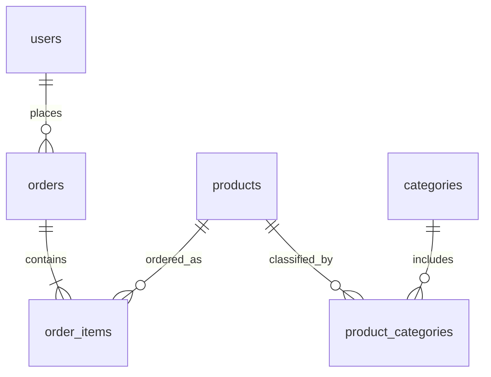
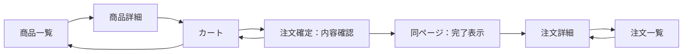

# ec-shop-gas のアイディア

## 目的と確定事項

- 他の GAS アプリと同程度の、小規模な学習用 EC アプリにする。
- 主な目的は、注文を扱う RDB の考え方とデータ設計を理解すること。
- ログイン不要。事前登録した架空のユーザーを選んで操作する。
- 保存先は Google スプレッドシート。1 テーブルを 1 シートとして再現する。
- 単一店舗として扱い、ショップテーブルは設けない。商品・注文の `shop_id` も不要。
- 商品とカテゴリーは多対多、ユーザーと注文は 1 対多。
- カート用テーブルは作らず、注文前の商品・数量を画面上で保持する。
- 必須ページは商品一覧・商品詳細・カート・注文確定・注文一覧・注文詳細の 6 ページ。

本書を現時点のプロジェクト要件・設計の正とする。README・CLAUDE・AGENTS は本書に合わせる。
以下のカラム・画面の詳細は、この確定事項に基づく初期仕様案。具体的な保存処理・実装の検証結果は、設計が固まり次第 `docs/05_data_model.md` などへ反映する。

ショップを省く理由は単一店舗で十分だからであり、ユーザーと注文の関係で販売元を表現できるからではない。

## 初期範囲

事前登録ユーザーを選ぶ → 商品を見る → カートに入れる → 注文内容を確認して確定する → 注文履歴を確認する。

- ユーザー・商品・カテゴリーは架空の初期データとしてシートへ登録する。管理画面は作らない。
- ユーザー選択は本人確認ではない。実在する個人情報は扱わない。
- カテゴリーは階層を持たせず、未分類の商品も許容する。
- 金額は日本円の整数。税額計算・送料・値引きは初期範囲に含めない。
- 決済、配送、在庫引当、会員登録、運営者の権限管理は初期範囲に含めない。
- 商品画像・説明文・検索・並べ替え・ページ分割は初期必須機能に含めない。
- カートの永続化・別端末との共有は行わない。

## テーブル構成

6 テーブルを、同名の 6 シートとして保存する。

| テーブル／シート | 日本語名 | 役割 |
|---|---|---|
| `users` | ユーザー | 誰が注文したかを表す |
| `products` | 商品 | 商品名・現在の価格・販売状態を持つ |
| `categories` | カテゴリー | 商品の分類を持つ |
| `product_categories` | 商品カテゴリー | 商品とカテゴリーの多対多を表す |
| `orders` | 注文 | 注文者・日時・状態を持つ |
| `order_items` | 注文明細 | 注文した商品・数量・注文時の商品名と単価を持つ |

注文と注文明細を分けることで、1 回の注文に複数種類の商品を含められる。
商品 ID のカンマ区切り保存や「商品1」「商品2」のような繰り返し列は使わない。

## ER 図

- ユーザーは 0 件以上の注文を持ち、各注文は必ず 1 ユーザーに所属する。
- 確定した注文は必ず 1 件以上の注文明細を持つ。
- 各明細は必ず 1 商品を参照する。
- 商品・カテゴリーは、中間テーブルを通じてそれぞれ複数の相手に関連付けられる。

## カラム案

PK は主キー、FK は外部キーに相当する論理的な制約を表す。スプレッドシートが自動で強制する制約ではない。
全カラムを必須とし、ID は文字列、金額・数量は整数、日時は共通形式で扱う。行番号を ID として使わない。

### users：ユーザー

| カラム | 型 | 意味 |
|---|---|---|
| `id` | 文字列 | PK |
| `name` | 文字列 | 表示名。同名を許容 |
| `created_at` | 日時 | 作成日時 |

認証用パスワード・メールアドレス・住所は持たせない。

### products：商品

| カラム | 型 | 意味 |
|---|---|---|
| `id` | 文字列 | PK |
| `name` | 文字列 | 現在の商品名 |
| `price` | 整数 | 現在の販売価格。0 以上、円単位 |
| `is_active` | 真偽値 | 販売中か。販売停止は false |
| `created_at` | 日時 | 作成日時 |

### categories：カテゴリー

| カラム | 型 | 意味 |
|---|---|---|
| `id` | 文字列 | PK |
| `name` | 文字列 | カテゴリー名。重複不可 |

### product_categories：商品カテゴリー

| カラム | 型 | 意味 |
|---|---|---|
| `product_id` | 文字列 | FK → `products.id`、複合 PK の一部 |
| `category_id` | 文字列 | FK → `categories.id`、複合 PK の一部 |

`(product_id, category_id)` の組み合わせを一意にする。独立した `id` は不要。
商品「コーヒー豆」に「食品」「ギフト」を付ける場合は 2 行を保存する。

### orders：注文

| カラム | 型 | 意味 |
|---|---|---|
| `id` | 文字列 | PK |
| `user_id` | 文字列 | FK → `users.id` |
| `status` | 文字列 | `confirmed`（確定）または `cancelled`（キャンセル） |
| `ordered_at` | 日時 | 注文確定日時 |

下書き注文は保存しない。状態遷移は `confirmed → cancelled` のみ。
注文合計は明細から計算し、合計金額のカラムは持たせない。

### order_items：注文明細

| カラム | 型 | 意味 |
|---|---|---|
| `id` | 文字列 | PK |
| `order_id` | 文字列 | FK → `orders.id` |
| `product_id` | 文字列 | FK → `products.id` |
| `product_name` | 文字列 | 注文時の商品名 |
| `unit_price` | 整数 | 注文時の単価。0 以上、円単位 |
| `quantity` | 整数 | 注文数。1 以上 |

`(order_id, product_id)` は一意。同じ注文内の同じ商品は数量をまとめる。
明細金額は `unit_price × quantity`、注文合計はその合計とする。
確定後は明細を編集せず、訂正は注文全体のキャンセルと再注文で行う。

## 注文時の商品名・価格を残す理由

`products` は現在の商品情報、`order_items` は注文時点の記録を表す。
500 円の商品を 2 個注文した後で価格が 600 円に変わっても、過去の注文は 1,000 円のまま表示する。
そのため、明細には注文時の `unit_price = 500` と商品名をコピーする。履歴を守るための意図的な重複である。
ユーザー名は現在の値を参照し、名前の履歴保存は初期範囲に含めない。

## ページと機能の仕様

6 ページは利用者から見た画面の区切り。別々の HTML ファイルや URL にするかは実装時に決める。

### 共通仕様

- 共通領域に、事前登録ユーザーの選択欄と「商品一覧」「カート」「注文一覧」への導線を置く。
- 初回はユーザー未選択。商品閲覧・カート編集は可能だが、注文確定・注文履歴の表示には選択が必要。
- ユーザー変更時は、確認を取ってカートと注文確認内容を消去し、前のユーザーの履歴表示を解除する。拒否した場合は切り替えない。
- カート・選択ユーザーは画面遷移中に維持する。ページ再読み込みやタブを閉じると失われる仕様とし、カートにその旨を表示する。
- 注文履歴のユーザー絞り込みは学習用の表示条件であり、認証・アクセス制御ではない。
- 読み込み中・空データ・取得失敗を区別して表示する。存在しない ID は「見つかりません」と表示し、一覧へ戻れるようにする。

| ページ | 主な表示 | 必須操作・機能 |
|---|---|---|
| 商品一覧 | 販売中の商品名・価格・カテゴリー | カテゴリーで絞り込み、商品詳細へ移動 |
| 商品詳細 | 商品名・価格・カテゴリー・販売状態 | 数量を指定してカートへ追加、カートへ移動 |
| カート | 商品名・参考単価・数量・小計・参考合計 | 数量変更、商品削除、買い物を続ける、注文確定ページへ移動 |
| 注文確定 | 選択ユーザー・最新の商品名／単価・数量・小計・合計 | 内容確認、カートに戻る、注文を確定、保存成功後の完了表示 |
| 注文一覧 | 選択ユーザーの注文 ID・注文日時・状態・合計 | 新しい注文順に表示、注文詳細へ移動 |
| 注文詳細 | 注文 ID・ユーザー・日時・状態・明細・合計 | 注文全体のキャンセル、注文一覧へ戻る |

### 商品一覧・商品詳細

- 商品一覧では `is_active = true` の商品を表示する。
- カテゴリー絞り込みは単一選択と「すべて」。多対多の結合で同一商品を重複表示しない。
- 商品詳細から追加する数量は 1 以上の整数。同じ商品を再追加した場合はカート内の数量を加算する。
- 販売停止商品の詳細を開いた場合は状態を表示し、カート追加を無効にする。
- 初期モデルにない画像・商品説明のためにカラムを追加することは、別の拡張として扱う。

### カート

- カートには商品 ID と数量を保持し、表示用の商品名・価格は商品情報から取得する。
- 数量は 1 以上の整数とし、0 や小数は受け付けない。削除は専用操作で行う。
- 空の場合は商品一覧への導線を表示し、注文へ進む操作を無効にする。
- 販売停止・存在しない商品が含まれる場合は該当商品を示し、削除するまで注文へ進めない。
- 価格は参考値とし、注文確定ページで最新の内容を再確認する。

### 注文確定

- このページへの移動だけでは保存しない。「注文を確定する」の操作で保存する。
- 選択ユーザーと空でないカートを必須にし、サーバー側で商品・数量・販売状態・最新価格を再検証する。
- 確認表示から確定操作までに商品名・価格が変わった場合は、更新内容を表示して再確認を求め、そのまま保存しない。
- 送信中は確定ボタンやユーザー変更を無効にする。二重注文の防止はサーバー側でも行う。
- 保存成功後は同じページを完了表示に切り替え、注文 ID と注文詳細への導線を表示する。カートは成功確認後に空にする。
- 保存失敗時はカートを保持する。通信切断などで成否不明の場合は、自動で新規注文を再送せず、同じ注文要求の結果を確認する。
- 独立した注文完了ページは設けない。

### 注文一覧・注文詳細

- 注文一覧は選択ユーザーの注文を対象に、確定済み・キャンセル済みの両方を表示する。0 件の場合は空表示にする。
- 注文詳細の単価・商品名・合計は、現在の商品情報ではなく保存した明細から表示する。
- 選択ユーザーと注文の `user_id` が一致しない場合は詳細を表示せず、ユーザー選択または一覧へ案内する。
- 確定済み注文は、確認操作を経て注文全体をキャンセルできる。サーバー側でもユーザー ID と注文状態を再検証する。
- キャンセルは `orders.status` だけを変更する。注文・明細は削除せず、金額もそのまま残す。
- キャンセル済みは再キャンセル・編集・確定への復帰を受け付けない。購入し直す場合は新規注文にする。

### 画面遷移

## スプレッドシートで整合性を保つ方針

RDB の PK・FK・UNIQUE・CHECK に相当する検証は GAS 側で実装する。
シートの入力規則だけに依存せず、注文保存時にも参照先の存在・ID の一意性・正しい数量と金額・販売状態を検証する。
注文で参照されているユーザー・商品は物理削除せず、販売終了は `is_active = false` で表す。

複数シートの書き込みは RDB のトランザクションではない。途中失敗・同時注文・再送への対処を実装前に具体化する。

初期の保存方式案：

1. 注文要求を識別する ID を用意し、同じ要求の再送では同じ ID を使用する。注文 ID と兼用する案を基本とする。
2. GAS 側で書き込みを排他し、同じ注文 ID が保存済みなら内容を照合して既存結果を返す。異なる内容での使い回しはエラーにする。
3. ユーザー・商品・数量・価格を再検証し、注文時点の明細を作る。画面から送られた価格を正として採用しない。
4. 注文明細を先に書き、全明細の保存を確認してから `orders` を書く。親注文がない明細は履歴表示の対象にしない。
5. 途中失敗で親注文がない明細が残った場合、同じ要求の再試行前にその注文 ID の明細を確認・除去してから再作成する。処理は同じ排他制御の対象とする。
6. 親注文・全明細の保存結果を確認して成功を返す。キャンセルも同じ排他方針で処理する。

これは RDB と同じ原子性を保証するものではない。タイムアウト・応答消失・残存明細からの復旧を含め、具体的な方式は実装時に検証する。
アプリの排他制御では手動のシート編集を防げないため、初期データや価格の手動変更は注文操作と同時に行わない。

## データ例

| 商品 ID | 商品名 | 現在価格 | カテゴリー |
|---|---|---|---|
| P01 | コーヒー豆 | 500 円 | 食品、ギフト |
| P02 | マグカップ | 800 円 | 食器、ギフト |

ユーザー U01 がコーヒー豆を 2 個、マグカップを 1 個注文した場合：

- `orders`：注文 O01 を 1 行作成し、U01 を記録する。
- `order_items`：O01 に対し、P01・単価 500 円・数量 2 と、P02・単価 800 円・数量 1 の 2 行を作成する。各行に注文時の商品名も残す。
- 注文合計：`500 × 2 + 800 × 1 = 1,800 円`。
- `product_categories`：上記の分類は合計 4 行。

## 受入条件

- 事前登録ユーザーを選び、商品一覧から商品詳細・カート・注文確定へ進める。
- 2 種類の商品を含む注文が、注文 1 行・明細 2 行として保存され、注文一覧・詳細で確認できる。
- 同一商品の再追加は数量加算となり、保存する明細は 1 行にまとまる。
- 商品価格の変更後も、過去の注文金額が変わらない。
- 空カート、不正な数量、存在しない／販売停止の商品では注文できない。
- 注文確認後の価格変更を検出し、変更内容を再確認してから注文できる。
- 連打・同一要求の再送で注文が増えず、途中失敗した注文を完了済みとして表示しない。
- キャンセル後も履歴・明細が残り、一覧と詳細にキャンセル済みと表示される。
- ユーザー変更時に前のユーザーのカート・履歴表示を引き継がない。

## 次に具体化すること

1. シートの初期データ・ID 採番・日時形式・数量や金額の上限。
2. 注文要求 ID の発行・再利用、排他制御、途中失敗・通信切断時の復旧方式。
3. GAS の画面構成・サーバー関数・画面間の状態保持。
4. 上記の受入条件に対応するテストと実機確認。
