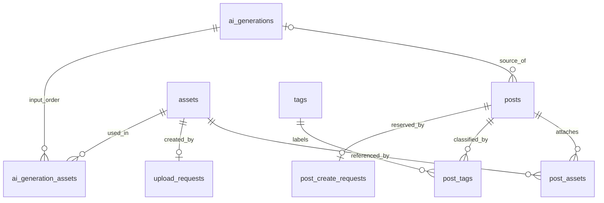

# DBリファクタリング調査・設計案

調査日：2026-10-25（Asia/Tokyo）  
状態：2026-10-25にローカル実装・検証完了。本番移行・公開反映は未実施。以下1〜11章は調査時点の記録で、実装結果と判断は12章、現在の仕様は [DB v2仕様](../../specs/database-v2.md) を参照。

## 1. 目的と結論

依頼：画像アップロードとAI機能が後付けになっているため、DB設計を根本から見直す。

**推奨は、GAS＋Sheets＋Driveを当面維持し、「日記」「画像資産」「添付」「操作の再送」「AI生成」の責務を分け、状態遷移と回復手順まで設計し直すこと。** 表名の変更だけでは、外部処理の途中失敗・再送・整理の問題は解決しない。

現行imagesは画像そのものではなく添付関係。uploadsは転送要求と画像資産を兼ね、file_idはダミーIDとDrive IDを兼用する。AI生成は永続化されず、最終本文だけが日記になる。この境界が拡張時の複雑さの中心である。

一方、子→親の書込、永続的な再送照合、Drive作成の回復、未完了添付の削除保護は実装済みであり維持する。AI履歴がないこと自体は現行MVPの不具合ではなく、追跡・応答回復を求める場合の不足である。

今回の成果物はこの文書のみ。作業中のローカルソースを調査対象とし、アプリ・確定仕様・本番データ・Drive・デプロイは変更していない。秘密情報ファイルは読んでいない。

## 2. 調査根拠

| 対象 | 主な参照先 |
|---|---|
| 表定義・保存層 | [tables.js](../../../src/server/db/tables.js)、[sheet-store.js](../../../src/server/db/sheet-store.js)、[seeder.js](../../../src/server/db/seeder.js)、[table-cache.js](../../../src/server/db/table-cache.js) |
| 日記保存・再送 | [diary-service.js](../../../src/server/services/diary-service.js)、[diary-repository.js](../../../src/server/models/diary-repository.js)、[request-repository.js](../../../src/server/models/request-repository.js) |
| 画像保存・整理 | [upload-repository.js](../../../src/server/models/upload-repository.js)、[upload-service.js](../../../src/server/services/photo/upload-service.js)、[drive-store.js](../../../src/server/services/photo/drive-store.js)、[upload-maintenance.js](../../../src/server/services/photo/upload-maintenance.js) |
| 画像解決 | [photo-service.js](../../../src/server/services/photo/photo-service.js)、[drive-photo-provider.js](../../../src/server/services/photo/drive-photo-provider.js) |
| AI生成 | [draft-service.js](../../../src/server/services/draft/draft-service.js)、[gemini-draft-provider.js](../../../src/server/services/draft/gemini-draft-provider.js)、[gemini-client.js](../../../src/server/services/draft/gemini-client.js) |
| 入力・画面 | [diary-validator.js](../../../src/server/services/diary-validator.js)、[form.html](../../../src/client/views/form.html)、[photo-upload.html](../../../src/client/core/photo-upload.html) |
| 仕様・既存検証 | [連携仕様](../../specs/photo-gemini-integration.md)、[データモデル](../../05_data_model.md)、[進行中タスク](README.md)、[uploads.test.mjs](../../../src/tests/uploads.test.mjs)、[server.test.mjs](../../../src/tests/server.test.mjs)、[gemini-draft.test.mjs](../../../src/tests/gemini-draft.test.mjs)、[gemini-images.test.mjs](../../../src/tests/gemini-images.test.mjs) |

実稼働シートの件数・不整合・公開版との一致は未確認。以下の「確認済み」はローカルコード確認または模擬再現を意味し、本番発生確認とは区別する。

## 3. 現行の構造と流れ

### 3.1 実際の6表

| 表 | 現行列 | 役割 |
|---|---|---|
| posts | id, title, body, created_at | 保存済み日記。AI由来は記録しない |
| images | id, post_id, file_id, sort_order | 日記への添付と順序 |
| tags | id, name | 分類タグ兼AI入力キーワード |
| post_tags | post_id, tag_id | 日記とタグの多対多 |
| uploads | upload_id, file_id, sha256, mime_type, byte_size, created_at, state | アップロード再送照合とDrive画像の情報 |
| requests | request_id, post_id | 保存要求と予約した日記IDの対応 |

TABLES.keyは空行除外と単一キー更新に使うもので、一意制約ではない。PK・FK・UNIQUEに相当する保証はアプリ側の責任となる。

実画像のimages.file_idはuploads.file_idに論理的に対応し、ダミー画像はMasterDataの目録で解決する。現コードは同じ画像を複数の日記に添付できる。

### 3.2 処理の時系列

1. **画像**：ブラウザで縮小 → uploadId付き送信 → ロック内でpending予約 → 決定的ファイル名でDrive作成／回復 → ready更新。日記保存より先に画像が存在する。
2. **AI**：画像・タグ・同意を受信 → 実画像の取得・検証 → Gemini呼出 → title/body検証 → フォームへ返す。要求ID・入力・出力・利用量・採用元の永続記録はない。
3. **日記**：ロック内でrequestId照合 → 検証 → requestsへpost_id予約 → images → post_tags → posts。再送時に親がなければ同じpost_idの子を除去して再作成。
4. **整理**：ready・保留期間経過・imagesから未参照を候補化。実行時に同じロック内で再確認 → Driveゴミ箱移動 → trashed更新。親のないimagesも保護対象。

## 4. 課題と優先度

| 優先 | 課題 | 根拠・影響 | 対応方針 |
|---|---|---|---|
| P0 | 同じ保存要求IDで異なる入力を区別しない | DiaryService.createは完了ID／親があれば入力比較なしで返す。模擬再現済み | 正規化入力のハッシュを保持し、不一致を競合にする |
| P0 | キャッシュ容量境界で古い表が残る | TableCache.putManyは上限超過をスキップし、既存値を削除しない。模擬再現済み | 超過時は対象キーを削除。失効失敗も扱う |
| P0 | 既存表の列変更・版管理がない | ensureTablesは既存表をスキップ。読みは実見出し、書きはTABLES順 | スキーマ版・見出し検査と専用移行処理 |
| P1 | 転送要求と画像資産の寿命が混在 | uploadsを削除すると実画像の解決もできなくなる | assetsとupload_requestsに分離 |
| P1 | 業務IDが保存先IDと同じ | dummy/Driveの判断がproviderに埋まる | asset_idとstorage_kind/storage_keyを分ける |
| P1 | 保存の進行状態が暗黙 | requestsは2列だけで親の有無から推定 | hash・状態・更新日時を持ち修復対象を識別 |
| P1 | AI成功応答の喪失から回復できない | 生成台帳がない。GeminiClientのusage/elapsedMsも生成フローでは保存されない | 生成要求・成功結果を保存し再取得できるようにする |
| P1 | 生成時点と日記保存時点の関係が不明 | 生成後に本文・写真・タグを変更できる | 生成入力のスナップショットと採用元ID |
| P1 | 未完了処理が放置される | pendingは手動照合。再送されない孤立childrenは削除保護を続ける | 照合・中止・修復手順を定義 |
| P2 | 更新判断にキャッシュが混在 | 要求検索はfreshだが画像照合やタグ読取等はキャッシュ経由 | 通常読取と更新判断用のAPIを分離 |
| P2 | 全表走査と広範囲な失効 | loadAllは全件結合。updateは複数回読取＋全表失効。Drive呼出も保存ロック内 | 操作内の読取集約、限定失効。ロック短縮は状態設計後 |

読取側が古い表を読み、更新側の失効後に古いキャッシュを書き戻す競合も考慮が必要。今回は並行再現していない。「更新後にclearする」だけで完全な整合性は保証しない。

docs/05_data_model.mdにはダミーfile_idやキャッシュだけの再送防止の旧説明が残り、追加仕様へ誘導している。設計確定時に統合する。

## 5. 提案する論理モデル

### 5.1 正本と関係

- posts：利用者が確定した日記の正本。AI生成本文とは別物。
- assets：転送要求の有無に依存しない画像資産の正本。
- post_assets：添付と順序の正本。assetsにpost_idやattachedフラグを重複保存しない。
- 操作台帳：再送・途中失敗の回復に必要な記録。
- ai_generations：1回の生成要求、当時の入力と結果。手入力保存では不要。

図は確定状態の論理関係であり、Sheetsの物理FKではない。予約直後は台帳だけが先に存在し、posts/assetsが未完成の場合がある。

### 5.2 テーブル案

`?`は任意。日時は内部Date・APIでは既存presenter規約の文字列、ID・ハッシュ・JSON・列挙値は書式なしテキスト。JSONにも形式と長さの検証を設ける。

| 表 | 主な列 | 制約・意味 |
|---|---|---|
| posts | id, title, body, created_at, source_generation_id? | id一意。採用元は成功した生成のみ。手入力・由来不明の旧データは空 |
| assets | id, storage_kind, storage_key?, sha256?, mime_type?, byte_size?, state, created_at, updated_at | id一意。キーありなら(kind,key)一意。Driveのreadyでは保存先・ハッシュ・MIME・容量必須。dummyの実バイト情報を捏造しない |
| post_assets | id, post_id, asset_id, sort_order | (post_id,asset_id)と(post_id,sort_order)一意。1始まり。枚数上限を検査 |
| tags | id, name | 現状維持 |
| post_tags | post_id, tag_id | 組の一意性・参照先を検査 |
| upload_requests | upload_id, asset_id, payload_hash, recovery_key, state, created_at, updated_at, error_code? | upload_id一意、初期案ではasset_idも一意。別要求の同内容は自動統合しない |
| post_create_requests | request_id, post_id, payload_hash?, state, created_at?, updated_at?, error_code? | request_id/post_id各一意。新規はhash・日時必須。復元不能な旧要求だけ不明を許す |
| ai_generations | id, request_id, input_hash, provider, model, prompt_version, input_snapshot_json, state, output_title?, output_body?, usage_json?, elapsed_ms?, error_code?, consent_at?, consent_version?, created_at, updated_at | id/request_id一意。入力と設定は予約後不変。成功結果を保持 |
| ai_generation_assets | generation_id, asset_id, sort_order, sha256? | 生成入力の順序と当時のハッシュ。組と(generation_id,sort_order)一意 |
| schema_migrations | version, name, checksum, state, started_at, completed_at?, checkpoint? | 適用版と再開地点。通常Seederから実行しない |

業務・操作9表＋移行管理1表の案。表が増えても日記表示で全表を読まない。通常表示はposts/post_assets/assets/tags/post_tags、台帳・AI履歴は必要時のみ読む。

upload_requestsとpost_create_requestsは別表を推奨。回復に必要な列・外部副作用が異なり、汎用requests表にまとめると種類別分岐と空列が増える。ID検証やハッシュ処理だけ共通化する。

assets.stateの候補はpending / ready / trash_pending / trashed / missing。missingはファイル不存在を確認した状態で、通信・権限エラーを即missingにしない。転送の成否はupload_requests、添付の有無はpost_assetsが正本。

### 5.3 AI履歴の範囲

input_snapshotには生成時点のタグIDと表示名、採用した文体設定、生成パラメータ、入力形式の版を保存する。画像ID・順序・ハッシュはai_generation_assetsを正本としJSONと二重管理しない。自由入力を追加する場合は分類タグと生成だけの指示を分ける。

prompt_versionだけでは指示を復元できないため、版に対応する不変テンプレートを保管するか、実際の指示を制限付きスナップショットで保持する。キー、base64、HTTPエラー生本文は保存しない。生成履歴には私的な日記内容が含まれ得るため、保持期間は実装前に決める。

source_generation_idは「その生成結果から編集を始めた」という由来であり、最終本文との一致を意味しない。再生成なら採用元を更新、手入力として作り直す場合は解除できる契約にする。既存日記のAI由来を推定して埋めない。

画像整理では、**実行中の生成だけ画像を保護し、終了済みの履歴参照だけで永久保護しない**案を推奨。ゴミ箱移動後もassetsのメタデータを残し、履歴は画像利用不可を表す。完全な再生成可能性が必要なら履歴と画像を同じ期間保持する別方針が必要。unknown処理の参照保護は手動照合で解除する。

送信確認は同意の時刻・文面版として記録し、mockではGemini送信の同意を記録しない。

## 6. 状態遷移と回復

### 6.1 日記作成

1. 新APIではrequestId必須。旧APIで省略できる期間は明示する。
2. サーバーで正規化してhash化。本文は現行の末尾空白規約、画像は順序保持、タグは重複排除して安定順。採用元生成IDも含め、正規化の版を固定する。
3. ロック内のfresh読取で照合。同ID・異内容はrequest_conflict。同ID・同内容・親ありは既存結果を返し、台帳の完了を補修する。
4. 新規はpost_idを予約してpending。入力・参照先検査後、子→親で書く。親を表示上のコミット点とし、最後に台帳をsucceededへ更新する。
5. 親なしの再送は予約・入力を確認して未完了の子を修復する。別入力で同一要求を上書きしない。

フォームは送信時入力を凍結して再送する。結果不明のまま編集した場合は元要求の状態を先に照会する。新しいrequestIdを無条件に発行すると二重日記になり得る。未完了要求の中止を確定してから別要求にする。完了済み日記の編集機能は今回のMVP範囲に追加しない。

### 6.2 アップロード

upload_requests予約時にasset_idとrecovery_keyを確保 → pending資産 → Drive作成／照合 → assets.ready → 操作succeeded。

決定的ファイル名と内容ハッシュによる回復を維持する。同名複数は停止、同uploadId異内容は拒否。assetがreadyで操作だけpendingなら結果照合で完了へ進める。予約とassetの片方だけがある場合も同じIDで再開する。

初期は現行のロック範囲を維持する。Drive呼出を外へ出す改善は、操作所有権・期限・実行世代番号・古い実行の書込拒否を設けてから行う。

### 6.3 AI生成

pending予約（入力固定・参照保護）→ running記録 → ロック外でGemini → 短いロック内で結果保存 → succeeded / failed / unknown。予約から実行開始の判定を同じロック内で行い、複数実行が同じ要求を処理しないようにする。

同ID・同内容・成功なら保存結果を返す。異内容なら競合、runningなら処理中。通信例外や中断で外部処理の成否を判断できなければunknown。

**要求IDをDBに持つだけでは、外部APIを厳密に1回だけ実行する保証にはならない。** Gemini応答後・結果保存前の停止は残る。unknownを自動再実行せず、新規生成として明示的に扱う。期限切れrunningを成功／失敗と推測しない。

### 6.4 整理・修復

ready・保留期間経過・添付なし・実行中AI参照なしが候補条件。実行直前はfresh読取＋共通ロックで再検査する。

trash_pending記録 → Driveゴミ箱移動 → trashed確定。途中失敗はDrive状態を照合して再開。trash_pendingへの添付・AI利用は禁止。完全削除は導入しない。

親なしpost_assetsも未完了保存の間は保護する。要求の中止を確定してから子を除去する。長期間のpendingやunknownは修復一覧で扱い、経過時間だけで削除しない。

## 7. 保存層・APIの変更方針

- SheetStoreにreadFresh/readManyFreshとスキーマ検証を設け、repositoryが内部メソッドreadSheet_へ直接依存する構造を改める。表示はキャッシュ、更新判断はfresh。
- SheetStoreは列と型、repositoryはキーと永続化、serviceは業務制約と状態遷移を担当。複合キーをTABLES.keyだけで代用しない。
- AssetRepository、UploadRequestRepository、PostCreateRequestRepository、GenerationRepositoryへ責務を分ける。日記はDrive IDを知らず、providerは外部サービス差分を担当する。
- APIはassetIdを基本とし、旧file_idは移行アダプターで解決。保存済み画像はasset.storage_kindで読み、新規保存先の設定と分離する。
- 一覧に画像バイト・AI履歴を含めない。遅延画像取得、保存直後の入力からの応答組立を維持する。
- キャッシュキーはデータセット識別子とスキーマ版を含める。上限超過で旧値を削除。古い読取の書戻しは世代付きキー等で制御し、失効・世代更新失敗時はfreshへ退避する。
- Seederは新規環境準備に限定。通常起動で破壊的移行をせず、スキーマ不一致は書込前に止める。

## 8. データ移行案

### 8.1 対応表

| 旧 | 新 | 注意点 |
|---|---|---|
| posts | posts | ID・本文・日時保持。source_generation_idは空 |
| images | post_assets | images.idと順序を保持し、file_idを対応表でasset_idへ変換 |
| uploads | assets＋upload_requests | pending・ready・trashedを保持。file_id空のpendingも移す。新IDの対応は固定 |
| ダミー目録 | storage_kind=dummyのassets | 参照中のIDは必ず移行。実画像情報を捏造しない |
| requests | post_create_requests | 親ありは完了候補、親なしは修復対象。元入力hash・要求日時は復元不能 |
| tags/post_tags | 同名の新表 | ID保持。重複・参照切れを監査 |
| AI履歴 | 移行元なし | 過去のモデル・同意・入力・出力を捏造しない |

現行DriveStore.readはuploadId・sha256・mime_typeから決まるファイル名の一致も検査する。新asset_idを命名に使うだけでは既存画像を読めない。旧名をrecovery_keyに保持するか旧名解決アダプターを設ける。実ファイルの改名・複製は不要。

重複file_id、dummy/DriveのID衝突、目録にもuploadsにもない参照は不整合一覧へ出す。SHA一致だけで統合しない。参照不能画像でも本文は捨てず、missing資産か隔離対象として扱う方針を決める。

旧requestsはhash不明として識別し、既存結果を返す移行互換経路を設ける。親なし旧要求を新入力で自動再開しない。元の要求内容を復元できないため、復旧／中止判断の対象にする。

### 8.2 手順とロールバック

1. キャッシュを介さず6表の見出し・件数・重複・参照切れ・未完了要求を監査するdry-runを作る。Driveの不明状態と欠損を区別する。
2. シート値・型・見出し・Drive参照一覧をバックアップし、復元手順を確認する。日記本文や画像を通常ログ・リポジトリへ出さない。
3. 同一ブックの別名v2表へ移行する。既存表を残し、retiredSheetsによる削除対象にしない。別ブック方式は現在のactive spreadsheet依存を変える必要がある。
4. 版・checksum・チェックポイント・旧→新ID対応を永続化し、中断再開でIDや件数が増えないようにする。
5. 本文・タグ集合・添付順序・画像件数・ready画像の読取を比較。未完了・不整合は別集計。
6. 短い書込停止と実行中処理の排出を行い、最終差分を確認して切替。長時間移行を1本のロックだけで維持しない。旧フォームの保存は版不一致として再読込を要求する。
7. 読書きを同じv2版へ切替、キャッシュを分離し、旧表を読取専用で保持する。

切替後に書込がなければ旧表へ戻せる。新規書込後は停止して差分を逆移行するかv2を修復する。コードだけを戻してデータが戻るとは扱わない。逆移行では旧uploadsの名前・ハッシュ等も再構成可能にする。AI履歴は旧版が読めなくても保持する。初回は二重書込を避け、停止切替で複雑さを抑える。

## 9. 実装順と受入条件

| 段階 | 作業 | 受入条件 |
|---|---|---|
| A | キャッシュ境界を独立修正、既存再送の特性テスト | 境界超過後も最新一覧、キャッシュ喪失後も重複作成なし |
| B | スキーマ検証・移行dry-run・モデル確定 | 不一致列への書込拒否、再実行可能な移行 |
| C | assets/post_assetsと転送台帳の分離 | 旧ダミー・旧Drive・新画像・3枚順序・再送回復を維持 |
| D | 保存要求hash・状態・画面再送契約 | 同ID異内容を拒否、完了応答喪失と未完了を区別 |
| E | AI要求・入力・結果・採用元の永続化 | 成功結果の再取得、unknownの自動二重送信なし、手入力保存可能 |
| F | 修復・整理・性能と公開検証 | 実行中参照を保護、途中失敗から回復、実環境フロー確認 |

追加する検証：

- Drive作成後、資産更新後、親保存後、AI応答後、ゴミ箱移動後など、各書込境界の前後で障害注入。
- 同IDの並行要求、整理と添付・AIの競合。模擬ロックだけで並行安全性を実証したことにしない。
- キャッシュ上限を超える瞬間、失効失敗、古い読取の書戻し、破損JSON、版変更。
- 移行中断再開、重複・参照切れ・pending・trashed・旧requests、型と旧Drive名の保持。
- 生成後の手直し・画像変更・タグ変更・再生成・採用元解除。
- 100/1,000/10,000日記の仮想データで読取回数・所要時間・容量を比較。目標値は実測後に決める。

実装時はsrcでnpm test、画面変更にはnpm run test:browserを実行する。実API・実Drive検証は別証跡とし、既存の成功件数を今回の検証結果として流用しない。

## 10. 未決事項と推奨初期値

| 判断 | 推奨・理由 |
|---|---|
| Sheets継続 | 継続。単一所有者・学習用に合わせる。多人数同時更新、厳密なDB制約、大量検索が必要ならRDBを比較 |
| AI履歴 | 要求・成功結果・入力由来を保存。保持期間と削除運用は実装前に決定（現時点では未決） |
| 書きかけ日記 | 今回は追加しない。必要ならdrafts/draft_assetsと整理時の参照保護を別設計 |
| 同じ画像の複数日記利用 | 現行どおり許可。同じ日記内の重複は禁止 |
| 同ハッシュの統合 | 行わない。別要求の同内容統合と再送の冪等性を分ける |
| 元画像・サムネイル | 縮小画像のみを維持。必要になればasset_variantsを追加 |
| ユーザー表 | 今回追加しない。複数ユーザー化では全資産・台帳・APIの所有権を別設計 |
| 既存データ | 保持移行。過去の試行データという記録だけで今回の削除を前提にしない |

DB製品の変更より先に、残すデータ・成功の定義・再開地点を決める。RDBへ移ってもDriveとAIの外部副作用の回復設計は残る。

## 11. 今回の検証結果

src/tests/gas-mock.mjsをNodeから読み込み、ファイルを追加せずメモリ上で実施。実Drive・Geminiへの通信なし。

| ケース | 手順 | 結果 |
|---|---|---|
| 同要求ID・異内容 | 初期化→title=A/body=originalをsame-requestで保存→title=B/body=changedを同IDで保存 | 両方ok=true、同じpost ID、返却title=A。内容差を検出しない |
| キャッシュ容量境界 | 初期化→日本語5,000文字の本文を別IDで7件保存→getAll→TableCache.clear→getAll | キャッシュ経由8件、消去後9件。初期2件＋7件のうち1件がキャッシュに反映されない |

既存の大容量テストは追加後にTableCache.clearしてから確認するため、境界を超えた瞬間の旧値残存を直接検査していない。

文書のローカルリンクと参照する実装を確認。文書だけの変更のためnpm test・ブラウザ検証・実API検証・push/deployは実施していない。実データ監査、公開環境での再現、移行時間、保持期間、最終スキーマは未確定。

設計確定後に[データモデル](../../05_data_model.md)、[アーキテクチャ](../../02_architecture.md)、[連携仕様](../../specs/photo-gemini-integration.md)、[リリース手順](../../08_release_runbook.md)へ反映する。本書は調査・判断・移行作業の記録として残す。

## 12. 実装結果（2026-10-25）

ユーザーの修正実施依頼に基づき、次をローカルへ実装した。AI履歴の保持方針はユーザー回答「30日後に手動整理」を採用した。

| 対象 | 実装内容 |
|---|---|
| モデル | v2_接頭辞の10表。assetsとpost_assets、upload_requestsとpost_create_requests、ai_generationsと画像関連を分離 |
| 整合性 | 見出し完全一致、TABLE_UNIQUE、fresh読取API、保存要求hash、同ID異内容拒否、未到着要求を含む中止記録 |
| キャッシュ | 書込中の利用停止と永続世代切替。容量超過・破損・旧読取の遅延書戻しを検証 |
| 画像 | asset_idを業務ID化。既存file_idレスポンスは互換エイリアス。旧Drive名をrecovery_keyとして保持 |
| AI | 入力と指示のsnapshot、生成状態、結果、利用量、同意時刻・版、採用元生成ID。外部呼出はロック外 |
| 回復 | 親保存後の台帳失敗、Drive作成後の資産更新失敗、AI応答後の保存失敗、ゴミ箱移動後の失敗を扱う |
| 整理 | 実行中AIも画像保護。30日経過の成功／失敗生成を手動整理し、日記と成功由来IDは保持 |
| 移行 | auditDatabaseV2→migrateDatabaseV2（500行単位）→verifyDatabaseV2Files（10画像単位）→activateDatabaseV2。旧表を保持し不一致で停止 |
| 初期化 | 通常起動で旧表削除・欠損表再作成をしない。新規初期化途中は明示再開可能 |
| 画面 | 保存失敗後の変更は元要求を照会／中止。AI応答喪失は同要求再取得。新規生成・採用元解除・履歴整理を追加 |

設計案からの具体化：assetsにもrecovery_keyを保持し、転送台帳なしで画像検証できるようにした。整理済み生成はsucceeded_purged/failed_purgedを区別し、失敗生成を成功由来として登録しない。旧APIの画像フィールド名は維持し、生成要求IDのない旧画面は再読込が必要。RDB移行・日記編集・下書き永続化・重複画像統合・自動削除は導入していない。

### 検証

- npm test：全96件成功（既存75件＋DB v2／画面回復の21件）。模擬GAS・jsdom。書込中読取や遅延書戻しは模擬割込みであり、実GASの並行負荷試験ではない。
- npm run test:browser：実ChromiumのPC幅1440px・スマホ幅390pxで画像変換、部分失敗再送、順序、同意、生成、手直し保存、再読込、画像整理が成功。画像読込表示・デコード失敗後再取得の追加試験も成功。通信先は模擬GAS/Drive/Gemini。
- node scripts/benchmark-db.mjs：100／1,000／10,000件の件数一致を確認。冷／温読取は5／0、5／1、5／1表。模擬実行時間は7／3、23／19、184／180ms。大容量postsはキャッシュせず、全件走査は残る。実GASの速度ではない。
- npx clasp show-file-status：送信対象はmanifest・server JS・client HTMLのみ。tests/scripts/test-results/node_modulesは対象外。push/deployは実行していない。
- 証跡：src/test-results/db-refactor-unit.txt、db-refactor-benchmark.json、browser-acceptance.json（いずれもローカル検証出力）。

### 本番適用時に残る作業

バックアップ、旧公開版を含む書込停止、本番監査・データ移行・Drive検証、既存デプロイ更新、公開画面とスマホ実機での確認は未実施。[08の移行手順](../../08_release_runbook.md)にまとめた。新規v2書込後の自動逆移行ツールは作っておらず、復旧はv2修復か差分逆移行を別途検証する。タスクは公開適用まで完了扱いにしない。
