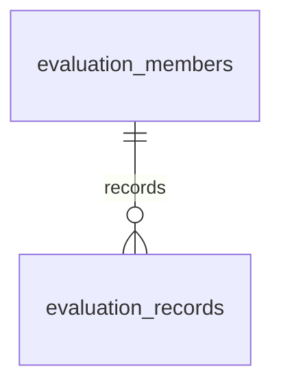

# キャスト評価のDB設計

2026-10-28再設計。既存の機能を維持し、教育用のデータ関係と制約を明確にする。認証・監査・AI台帳・独自復旧機能は追加しない。

## 固有データ

| 表 | 主キー・主な列 | 保証すること |
|---|---|---|
| evaluation_members | id、name、active、version | 表示名、在籍状態、競合検知 |
| evaluation_records | id、member_id FK、business_date、drinks／bottles／nominations／accompaniments／sales、version | メンバー×営業日UNIQUE、非負範囲内の実績 |
| evaluation_rules | category PK、unit、points、enabled、version | 固定5カテゴリの計算単位・配点 |

操作対象のユーザーと評価対象メンバーは別概念。app_usersへ統合しない。実績5項目は固定列を維持し、万能な項目名・値の表へ変更しない。

unitは0超〜10億、pointsは0〜100万、小数2桁までをDBでも保証する。numericの桁指定による暗黙の丸めを避け、無指定numericにscaleと範囲のCHECKを付けて拒否する。versionは3表とも非負、更新は旧versionと照合する。

順位・月次合計は現在のルールで都度計算し、保存表は追加しない。退籍者の既存実績は残す。同点・月境界の計算は既存コードを維持する。日付とメンバーの既存索引、メンバーと日付のUNIQUE索引を維持。

## 共通6表と移行

共通6表（app_users／app_settings／allowed_ai_models／posts／post_requests／image_cleanup）は[templateの設計](../../template/docs/database-design.md)を参照。posts・post_requestsはコピーした投稿見本であり、上記の教材固有データを保存する表ではない。CSV・投稿処理・参照確認から依存があるため、DBだけを削除しない。

[V12__evaluation_integrity.sql](../src/main/resources/db/migration/V12__evaluation_integrity.sql)で追加した。適用済みファイルは変更しない。新規DBは全履歴、既存DBは追加分で同じ最終構造へ到達する。データが新制約に違反すれば移行を止め、勝手に切捨てない。

進捗・公開反映・検証結果は[公開・検証状況](../../docs/rollout-status.md)で管理する。ローカルの設計変更と公開DBの反映は区別する。
