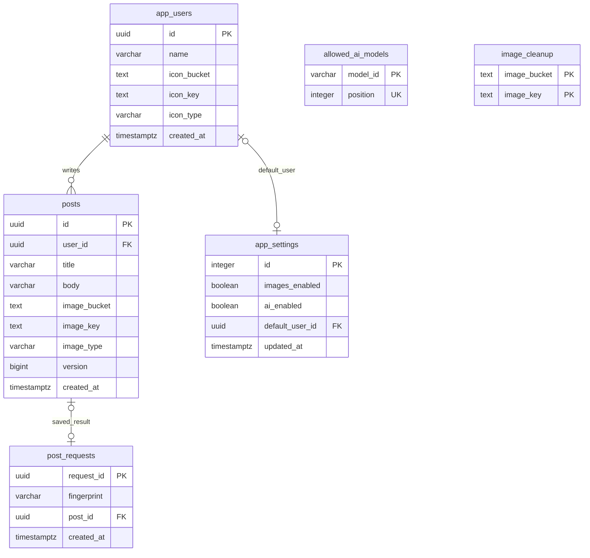

# 教育用DBの再設計（V10）

2026-10-27。現在のDB仕様の正本。既存の機能追加履歴ではなく、教材の最小完成範囲から構造を決め直す。認証、監査、AI台帳、バックアップシステム、汎用業務エンジンは追加しない。

## データの中心

学習者が扱うのは「投稿者が投稿を書く」「画像を1枚付ける」「設定で動作を変える」。まずこの関係を直接読める形にする。画像の実体はStorage、DBにはバケット・キー・形式だけを置く。投稿者は認証アカウントではない。

## 稼働用の6表

| 表 | 保存するもの | 判断 |
|---|---|---|
| `app_users` | 投稿者名・作成日時・任意のアイコン1枚 | アイコンは投稿者の属性。別表・別ライフサイクルを持たせない |
| `posts` | 投稿者FK・タイトル・本文・任意画像・日時・編集版 | 投稿教材固有。ショップの注文や英語の学習結果をこの表へ無理に入れない |
| `app_settings` | id=1の1行。画像許可・AI許可・既定投稿者・更新日時 | 型のある列。何でも入るキー値表やJSON設定にしない |
| `allowed_ai_models` | 許可モデルID1行1件、表示順0〜19 | 改行区切り文字列を廃止。重複・形式・最大件数を制約で表す。0件は全モデル禁止 |
| `post_requests` | 作成要求ID・内容ハッシュ・保存先 | 通信切断後の再送で投稿を増やさないためだけ。本文・画像・AI実行履歴を積まない |
| `image_cleanup` | 削除に失敗した画像のバケット／キー | 既存画像の参照を確認して再試行。監視画面・常駐処理は設けない |

Flywayの管理表はこの6表とは別。`user_icons` は `app_users.icon_*` に移して廃止。`operation_events`・`ai_requests` は稼働スキーマから外す。データがある旧表だけ `<元スキーマ>_legacy` に移し、空表は削除する。退避先をアプリから参照しない。

## DBで保証すること

- 投稿者のない投稿を許さない。投稿から参照されているユーザーの削除は拒否する。
- 既定ユーザーの削除時は設定をNULLへ戻す。
- 投稿画像・アイコンは3項目すべてNULL、または3項目すべて有効。空の場所・形式の欠落を拒否する。
- 投稿の編集版は0以上。更新時に版を比較し、競合した変更で上書きしない。
- 送信受付の投稿FKは削除時にNULLになる。受付自体は残し、「削除済み」を返す。同じ要求で投稿を復活させない。参照先のないUUIDを残さない。
- 許可モデルは重複なし、明示された順序。設定の変更は1トランザクションでまとめ、並行保存を1行の設定ロックで直列化する。
- RLSとanon/authenticatedへのDB権限解除を維持する。ログイン機能の追加とは別。

## 画像投稿の保存順

1. 要求IDが保存済みなら受付を返す。異なる内容・削除済み要求は拒否する。
2. 入力・投稿者・画像許可を検証する。
3. 試行ごとに別のランダムキーで画像をアップロードする。この間はDBトランザクションを開かない。
4. 短いDBトランザクションで要求IDをロックし、再確認→投稿INSERT→受付INSERT→コミットする。
5. 同時送信で先に別の処理が保存していた場合、今回だけの未使用画像を後片付けする。
6. DB失敗時は参照確認付き後片付けを試みる。通信切断でコミットの返事だけが失われた場合にも、保存済み画像を消さない。

StorageとPostgreSQLの完全な分散トランザクションは実装しない。アップロード直後のプロセス強制終了などでは未参照画像が残る可能性がある。これを解消する常駐監視・運用基盤を教材へ追加しない。

## 読取りと索引

- 通常の投稿一覧は検索語なしの単純な条件とORDER BY／LIMIT。空検索のために全投稿の本文へ文字列関数を実行しない。
- `(created_at DESC,id)` と `(user_id,created_at DESC,id)` を残す。同じ先頭列を持つ旧 `posts_user_created` は廃止。
- 投稿画像とアイコンの参照確認用に、画像がある行だけの `(bucket,key)` 索引を設ける。
- 投稿者単体の取得・選択・存在確認では投稿件数を集計しない。使用件数は管理一覧、CSV、削除判定だけで取得する。
- 部分一致検索は小規模教材向けの走査を許容する。検索エンジン、全文検索拡張、キャッシュ層、件数の重複保存は導入しない。

## 移行と反映

適用済みV1〜V9は変更しない。`V10__educational_core.sql` を新しいコードとセットで適用する。投稿ID・ユーザーID・本文・日時・画像キー・設定値は維持する。既存の孤立した受付は投稿参照をNULLへ正規化する。

V10は旧コードと互換性がない。旧コードが使うDBへ新コードを先に起動して、旧コードも同時稼働させるローリング更新は行わない。ローカルでは旧プロセスを停止してから起動する。Renderへ反映する場合も旧アプリの停止を伴う切替が必要。旧コミットへのコード差戻しだけでは戻せない。DBを初期化する手順は使わない。

`_legacy` 付きスキーマ名は63文字以内。長すぎる既存名や不正データがあれば移行を失敗させ、推測で切り捨てない。新しいインストールもV1〜V10で同じ6表へ到達する。

## 横展開で変更するところ

共通候補はユーザー（認証ではない）・型付き設定・必要な画像処理。`posts` と `post_requests` は投稿教材の実例であり全教材の必須DBではない。じゃんけんなら対戦、ショップなら注文と明細、英語なら学習結果をそれぞれの表で表現する。カート・問題管理等は採用した教材でだけ追加する。全教材に備えた空テーブルは作らない。

## 検証

旧V9の投稿・画像参照・アイコン・設定・旧履歴を入れた専用スキーマからの移行、制約違反の拒否、同時再送、削除後の再送、アップロード中のDBトランザクション不在をテストする。Java回帰と実Storageを使うPlaywrightの結果は作業記録へ残す。SQLを整理しただけで公開先の速度改善を達成したとは扱わない。
