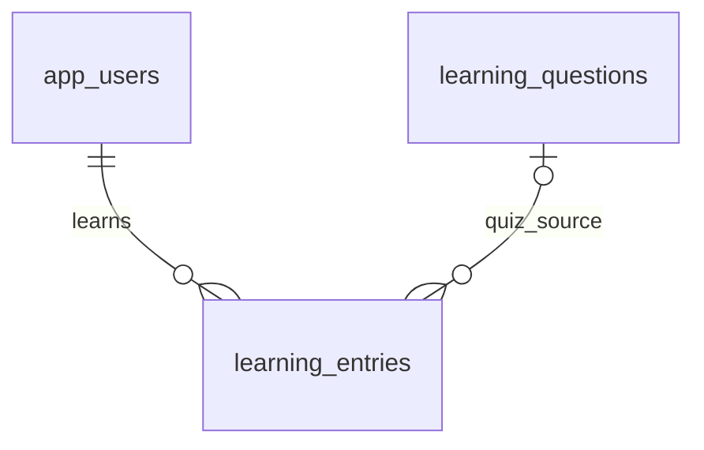

# 英語訓練のDB設計

2026-10-28再設計。既存の機能を維持し、教育用のデータ関係と制約を明確にする。認証・監査・AI台帳・独自復旧機能は追加しない。

## 固有データ

| 表 | 主キー・主な列 | 保証すること |
|---|---|---|
| learning_questions | id、prompt、answer、position UNIQUE、active | 読取り用の問題3件。空白問題／参考回答禁止、非負の表示順 |
| learning_entries | id、user_id FK、kind、question、input、feedback、fingerprint、created_at | QUIZ／CHAT／REFLECTの成功履歴。入力1〜1000文字、空白結果禁止 |
| 同上の問題参照 | question_id 任意FK、reference_answer 任意 | QUIZだけ問題参照・参考回答を持つ。回答時の文を保持 |

既存の問題文・入力・結果は変更しない。移行では問題文が一意一致する旧QUIZだけIDを結び、過去の参考回答は推測せずNULLにする。新規QUIZは現在の問題文・参考回答をスナップショットとして保存。問題管理画面・版履歴表は追加しない。

問題は使用停止を基本とし、履歴が参照する問題の削除はFKで拒否。CHAT／REFLECTに架空の問題を付けない。同じ要求の再送では先に保存済み入力を照合し、問題変更・使用停止後も保存済み結果を返す。AI失敗は保存しない。

会話の文脈はuser_idとkind='CHAT'で絞って直近2件を取得する。クイズが20件以上続いても会話が消えない。履歴索引(user_id,created_at DESC,id)を維持し、現在の小規模データで追加索引は設けない。AIの外部処理を完全な一回実行にする台帳は導入しない。

## 共通6表と移行

共通6表（app_users／app_settings／allowed_ai_models／posts／post_requests／image_cleanup）は[templateの設計](../../template/docs/database-design.md)を参照。posts・post_requestsはコピーした投稿見本であり、上記の教材固有データを保存する表ではない。CSV・投稿処理・参照確認から依存があるため、DBだけを削除しない。

[V12__learning_questions.sql](../src/main/resources/db/migration/V12__learning_questions.sql)で追加した。適用済みファイルは変更しない。新規DBは全履歴、既存DBは追加分で同じ最終構造へ到達する。データが新制約に違反すれば移行を止め、勝手に切捨てない。

進捗・公開反映・検証結果は[公開・検証状況](../../docs/rollout-status.md)で管理する。ローカルの設計変更と公開DBの反映は区別する。
