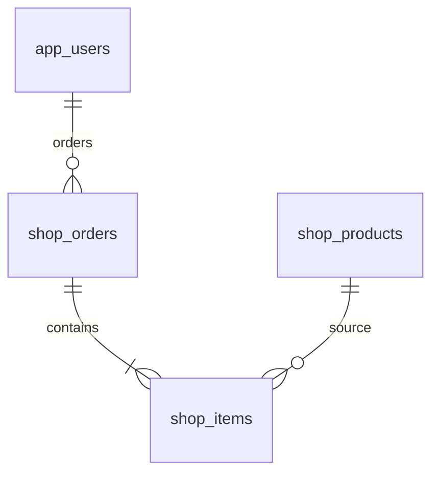

# ショップのDB設計

2026-10-28再設計。既存の機能を維持し、教育用のデータ関係と制約を明確にする。認証・監査・AI台帳・独自復旧機能は追加しない。

## 固有データ

| 表 | 主キー・主な列 | 保証すること |
|---|---|---|
| shop_products | id、name、description、price、active | 商品名空白禁止、価格範囲、販売状態 |
| shop_orders | id、user_id FK、fingerprint、created_at、cancelled_at | 同一要求の重複注文防止、取消は作成以降 |
| shop_items | (order_id,product_id)複合PK・FK、product_name、unit_price、quantity | 確定時の商品名・価格を保存、数量1〜99 |

図の明細1件以上は注文サービスが同一トランザクションで保証する。FKだけで空注文を禁止するものではない。カートはDBへ永続化しない。注文後に商品名や価格が変わっても明細は変更しない。取消は日時を設定し、履歴や明細を削除しない。

確認画面の商品照会は集合で1回。確定時は商品ID順で一括ロックし価格・販売状態を再検証する。要求IDのロックと内容比較を維持し、同じ要求で異なる内容は拒否する。

全体履歴は(created_at DESC,id)で先に30件を選び、該当明細だけ集計する。既存(user_id,created_at DESC,id)は参照確認用に残す。合計金額の保存列・在庫・決済表は追加しない。

## 共通6表と移行

共通6表（app_users／app_settings／allowed_ai_models／posts／post_requests／image_cleanup）は[templateの設計](../../template/docs/database-design.md)を参照。posts・post_requestsはコピーした投稿見本であり、上記の教材固有データを保存する表ではない。CSV・投稿処理・参照確認から依存があるため、DBだけを削除しない。

[V12__shop_integrity_and_feed.sql](../src/main/resources/db/migration/V12__shop_integrity_and_feed.sql)を追加する。適用済みファイルは変更しない。新規DBは全履歴、既存DBは追加分で同じ最終構造へ到達する。データが新制約に違反すれば移行を止め、勝手に切捨てない。

進捗・公開反映・検証結果は[統合実行計画](../../教育用アプリ横展開の残作業ゼロまでの実行計画.md)で管理する。ローカルの設計変更と公開DBの反映は区別する。
