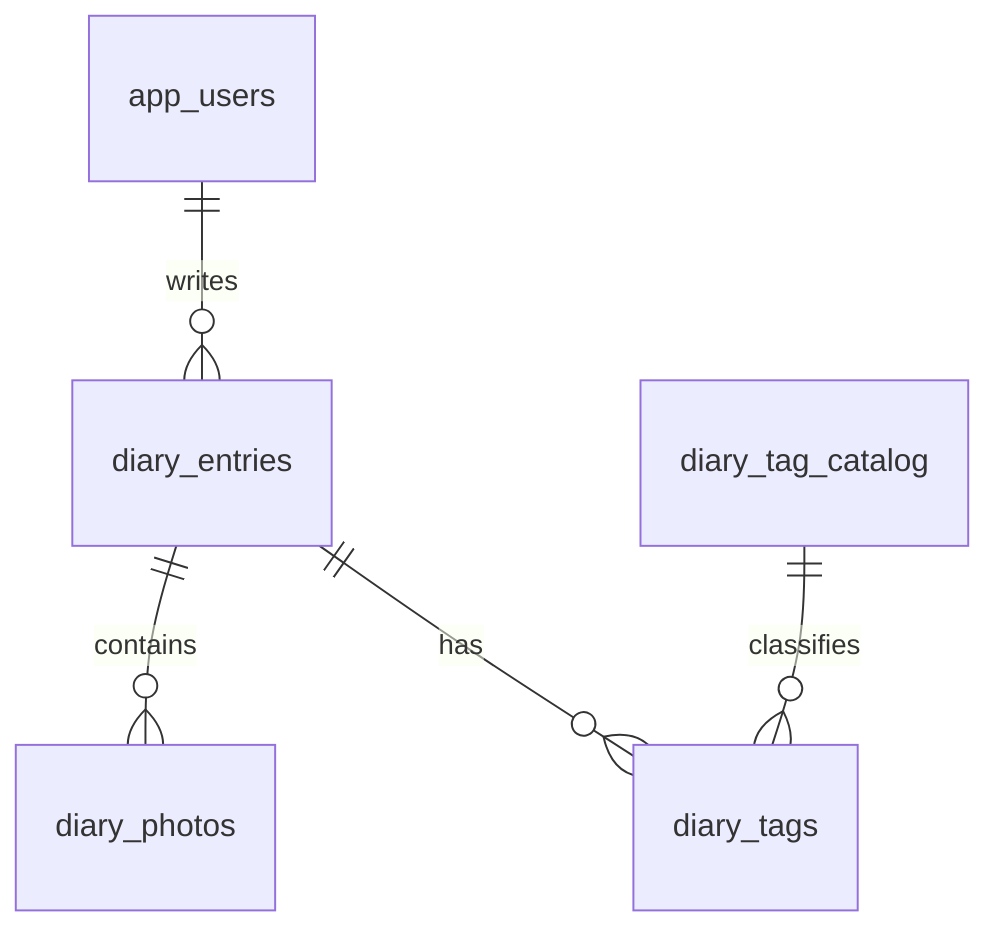

# 写真日記のDB設計

2026-10-28再設計。既存の機能を維持し、教育用のデータ関係と制約を明確にする。認証・監査・AI台帳・独自復旧機能は追加しない。

## 固有データ

| 表 | 主キー・主な列 | 保証すること |
|---|---|---|
| diary_entries | id、user_id FK、entry_date、title、body、fingerprint、created_at | ユーザー必須、空白タイトル／本文禁止、再送同一性 |
| diary_photos | id、entry_id FK、position、image_bucket／key／type | 位置0〜2、日記内位置UNIQUE、場所UNIQUE・空白禁止 |
| diary_tag_catalog | id、name UNIQUE、version | 使用中タグ削除拒否、非負versionによる競合検知 |
| diary_tags | (entry_id,tag_id)複合PK・FK | 日記とタグの多対多、重複関連禁止 |

フォーム・ページ切替・保存はタグUUIDを使用する。旧タグ名のURLと開いたままのフォームも受け付ける。新しい一覧のページリンクはUUIDへ正規化。表示名変更でも同じIDを使う。タグは最大5件をサービスで検証し、保存時にID集合を一括照会して参照を保護する。

新規保存のfingerprintはタグIDをソートして作る。旧保存済みデータは書き換えず、旧形式の同一要求も再送可能。既存の日記ID・画像場所・タグ関係を維持する。

フィード順、ユーザー参照、中間表両方向、画像場所の既存索引を維持。画像はStorageで保存し、DB失敗時の後片付けと参照保護を使う。画像保存中にDBトランザクションを保持しない。

## 共通6表と移行

共通6表（app_users／app_settings／allowed_ai_models／posts／post_requests／image_cleanup）は[templateの設計](../../template/docs/database-design.md)を参照。posts・post_requestsはコピーした投稿見本であり、上記の教材固有データを保存する表ではない。CSV・投稿処理・参照確認から依存があるため、DBだけを削除しない。

[V13__diary_integrity.sql](../src/main/resources/db/migration/V13__diary_integrity.sql)を追加する。適用済みファイルは変更しない。新規DBは全履歴、既存DBは追加分で同じ最終構造へ到達する。データが新制約に違反すれば移行を止め、勝手に切捨てない。

進捗・公開反映・検証結果は[統合実行計画](../../教育用アプリ横展開の残作業ゼロまでの実行計画.md)で管理する。ローカルの設計変更と公開DBの反映は区別する。
