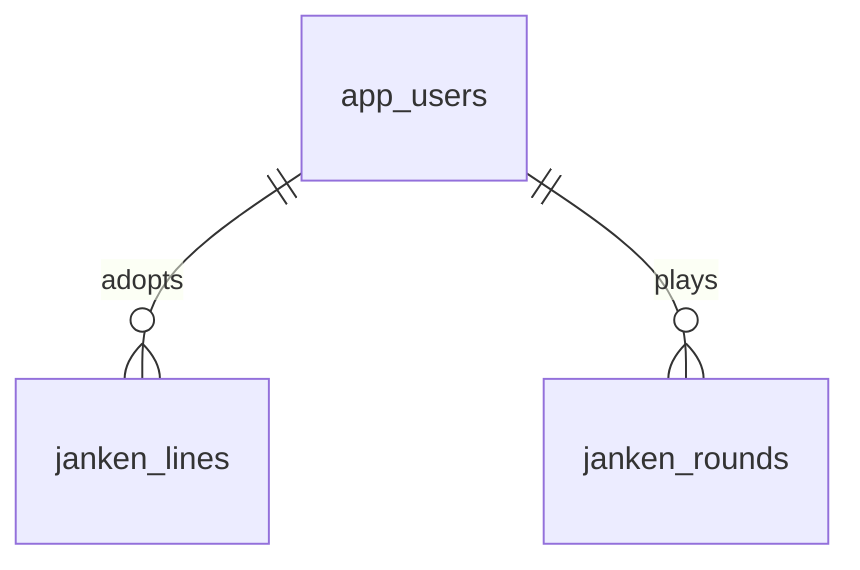

# スキルじゃんけんのDB設計

2026-10-28再設計。既存の機能を維持し、教育用のデータ関係と制約を明確にする。認証・監査・AI台帳・独自復旧機能は追加しない。

## 固有データ

| 表 | 主キー・主な列 | 保証すること |
|---|---|---|
| janken_lines | (user_id,character)複合PK、line | 仲間ごとの現在の採用セリフ |
| janken_rounds | id、user_id FK、character、skill、hand、cpu、outcome、points、line、created_at | 対戦時のスキル・勝敗・点数・セリフを固定保存 |

Web版のスキルは必須。ひのこは勝ち／負け、しずくは負け／あいこ、このはは勝ち／あいこのボーナスを選べる。通常の勝ち2点・負け／あいこ1点に、選んだ結果なら1点加算する。スキルは勝敗を操作せず、JavaのRoundRulesが適合する仲間・スキルと得点を検証する。

履歴側も仲間の許容値と空白セリフ禁止をDBで保証する。スキル・手・勝敗の許容値と得点1〜3は既存制約を維持。勝敗ロジックをSQLへ重複実装しない。

AIはセリフの事前生成だけ。採用後の文はDBへ保存し、対戦中はAIを呼ばない。採用文を変えても過去の履歴のlineは変更しない。要求IDの再送で同じ対戦結果を返し、加点を重複させない。合計点は履歴から算出する。

## 共通6表と移行

共通6表（app_users／app_settings／allowed_ai_models／posts／post_requests／image_cleanup）は[templateの設計](../../template/docs/database-design.md)を参照。posts・post_requestsはコピーした投稿見本であり、上記の教材固有データを保存する表ではない。CSV・投稿処理・参照確認から依存があるため、DBだけを削除しない。

[V12__janken_integrity.sql](../src/main/resources/db/migration/V12__janken_integrity.sql)を追加する。適用済みファイルは変更しない。新規DBは全履歴、既存DBは追加分で同じ最終構造へ到達する。データが新制約に違反すれば移行を止め、勝手に切捨てない。

進捗・公開反映・検証結果は[統合実行計画](../../教育用アプリ横展開の残作業ゼロまでの実行計画.md)で管理する。ローカルの設計変更と公開DBの反映は区別する。
