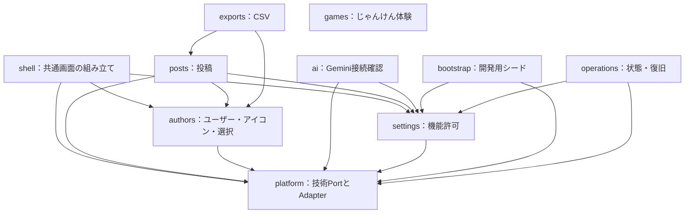

# テンプレートの構造と改修の入口

2026-10-27。提供者が機能を改修し、失敗を検証しやすくするための設計資料。利用者が全層を学ぶことを利用開始の条件にはしない。

採用方針は **Clean Architecture × DDD Lite × Modular Monolith**。一つのSpring Bootアプリ・一つのDBで動かし、機能間の境界をテストで守る。[採用理由（ADR）](../../../../../docs/adr/0002-web-template-modules.md)も参照。

5教材から逆算した[共通仕様](shared-foundation-requirements.md)を実装。AI疎通・任意画像付き下書き・永続要求管理を `ai` に置き、利用者参照・画像列挙・復旧対象は教材側Adapterから提供する。汎用CRUD生成・汎用会話エンジンは導入しない。

## 機能と依存方向

Javaの起点は `com.example.webapptemplate`。各モジュール直下の公開APIを通して連携し、他モジュールの `internal` を参照しない。



| モジュール | 公開API・担当 |
|---|---|
| `posts` | `PostOperations`、`PostView`。投稿の検索・一覧・作成・編集・削除・同一要求の再送 |
| `authors` | `AuthorOperations`、`AuthorView`、`UserIcons`。登録・名前編集・削除・既定ユーザー・選択解決・アイコン |
| `ai` | `AiConnectivity`、`AiDrafts`。固定文疎通、画像付き下書き、要求台帳、許可検査、Gemini HTTP Adapter |
| `settings` | `FeaturePolicy`、`SettingsOperations`。画像投稿・AI利用の許可と設定保存 |
| `platform` | `ImageStore`、`ImageCodec`、`ImageCleanup`、`UnitOfWork`。外部保存・画像変換・後片付け・トランザクション |
| `shell` | 共通ナビと画面モデル。機能の公開APIを呼ぶWeb側の組み立て |
| `exports` | CSV用のWeb Adapter。ユーザー・投稿の公開読取APIを利用 |
| `games` | DB不要の画面。ルールはブラウザー側の純粋関数 |
| `bootstrap` | 明示実行のシードコマンドとSQL Adapter。通常の業務処理から利用しない |
| `operations` | 接続状態、画像検査・再試行、バックアップ・隔離した復元。対象は `RecoveryDataset` と `ImageReferences` で受け取る |

## 一つの機能の中

```text
posts/
  PostOperations.java                 他機能が呼ぶ公開API
  PostView.java                       読取結果
  internal/
    domain/PostContent.java           タイトル・本文の不変条件
    application/PostService.java      保存・失敗時の補償などの手順
    application/PostStore.java        手順から見たDB保存のPort
    adapter/web/PostController.java   HTTP、入力保持、画面とJSON応答
    adapter/persistence/JdbcPostStore.java  SQL
    PostsConfiguration.java           Springによる接続
```

Web → Application → Domain の順に呼ぶ。ApplicationはPortを呼び、JDBCやSupabaseのAdapterが実装する。DomainとApplicationはSpring・HTTP・SQL・ImageIOに依存しない。全クラスにinterfaceを作らず、外部境界と他機能向けAPIに絞る。処理のないゲームに空のJava Domain/Application層は作らない。

`PostContent` がタイトル1〜120文字・本文5000文字以内、`AuthorName` が名前1〜80文字を検査する。コントローラー経由でなくても同じ制約が働く。`AuthorDeletion` は関連データの利用件数があるユーザーの削除を拒否する。

投稿一覧は `PostOperations.search()` が検索語・投稿者・日時の新旧順・ページを受け、1ページ10件の `PostPage` を返す。JDBC Adapterで件数と対象行を取得し、`LIMIT/OFFSET` を適用する。`page()` の基本一覧と `posts()` のCSV向け全件取得も維持する。V5で全体・投稿者別の複合インデックスを追加している。深いページのOFFSETと総件数のCOUNTにはデータ量に応じた負担が残るため、大規模化した場合は別途検討する。更新中の一覧はライブデータであり、ページ移動をまたぐスナップショットは保持しない。

削除ではユーザー行をロックし、利用件数を確認してからアイコンの後片付けを登録し、ユーザーを削除する。全処理を同じDBトランザクションで行い、外部キー制約を最後の競合防止として維持する。

`JdbcAuthorStore` はユーザー本体だけを照会する。教材側の `UserReferences` から利用件数をまとめて取得し、`AuthorView.usageCount` へ投影する。投稿では `PostUserReferences` が件数を提供する。別教材は同じPortを実装する。ユーザーなし・参照なしの構成でも動作する。投稿側のユーザー名の読取結合は同一DB内の明示的な参照として維持する。

## 画像とトランザクション

| 役割 | Port | 実装 |
|---|---|---|
| 画像の保存・取得・削除 | `ImageStore` | `SupabaseImageStore` |
| JPEG/PNG検査・再エンコード・256pxアイコン | `ImageCodec` | `ImageIoCodec` |
| DBの一括処理 | `UnitOfWork` | `SpringUnitOfWork` |
| 削除待ち画像の再試行 | `ImageCleanup` | `RetryImageCleanup` + `JdbcCleanupQueue` |
| 参照中の画像を削除しない照会 | `ImageReferences` | 投稿・アイコンの各JDBC Adapter |

`ImageUpload` はHTTPファイル型ではなく、上限検査済みのバイト列。`Uploads` がWebの `MultipartFile` から変換する。画像設定は `FeaturePolicy` で判断し、StorageのAdapterに業務設定を持ち込まない。投稿がOFFでもユーザーアイコンは使用できる。

投稿は画像保存後にDB登録し、DB失敗時に今回の画像を削除する。投稿削除時は投稿の削除と画像削除待ちを同じDBトランザクションで記録し、コミット後に後片付けする。アイコンの差し替え・ユーザー削除・シード置換も削除待ち情報をDBへ残す。`platform` は具体的な投稿・ユーザーテーブルを知らず、各機能が提供する `ImageReferences` で参照を確認する。

投稿作成の補償削除自体が失敗した場合は削除待ちキューへの記録を試み、操作記録を残す。全アップロードの強制終了・DB接続断まで完全に復旧する仕組みではない。運用画面は `ImageReferences.images()` を列挙し、復旧は `TemplateRecoveryDataset` の明示した表・画像列・復元可否を使用する。

開発用シードは固定ID・日時・複数テーブルを扱うため `bootstrap/internal/adapter/persistence` に隔離する。Domainの手本としてシードのSQLを業務Serviceへコピーしない。通常起動時には実行しない。

## 選択ユーザーと機能設定

- ブラウザーの選択：`currentAuthor` Cookie。`BrowserSelection` がHTTPへの書き込み、`AuthorOperations.selected()` が存在確認とフォールバックを担当する。認証ではない。
- デフォルトユーザー：DBの `app_settings.default_user_id`。ユーザー機能が担当し、選択済みCookieを書き換えない。
- 画像・AI許可：DBの `app_settings`。設定機能が担当する。同じテーブルでも、既定ユーザー更新と機能許可更新のPortを分ける。

機能禁止は画面の非表示だけでなく処理開始時にも確認する。AI疎通・下書きは `FeaturePolicy` で全体許可・モデル完全一致・画像許可を送信前に検査する。

## UIの境界

- `templates/ui` と `static/ui`：幅・共通部品・ポップアップの配置・フォーカス・削除確認・画像プレビュー。
- `static/features/authors/user-selection.js`：選択一覧の取得、検索、CSRF付き切替。成功時に `app:user-selected` を発行。
- `static/features/posts/posts.js`：下書きと添付を維持して投稿者を反映し、投稿の非同期保存を行う。
- `static/examples/janken-rules.js`：DOM・乱数に依存しない勝敗と加点の計算。`skill-janken.js` が画面と乱数を担当。

共通JSはユーザーAPIへ通信しない。機能別JSが `AppUI` の共通操作を利用する。URL・テーマ・既存の画面導線は維持する。部品の詳細は[共通UI設計](ui-foundation.md)を参照。

## 小さな変更を追う例

「ユーザー名の上限を変える」なら、まず `authors/internal/domain/AuthorName` のルールと `DomainTests` の境界値を変更する。次にユーザー登録画面・投稿画面内の追加フォームの `maxlength` とエラー説明を合わせ、DB制約に影響する場合は既存マイグレーションを書き換えず新規マイグレーションを追加する。JavaとPlaywrightのユーザー登録・切替を確認する。

「画像の保存先を変える」なら `ImageStore` の別Adapterを用意し、Springの接続先を切り替える。投稿のルール・手順・画面は変更しない。失敗時の削除・旧画像の参照確認も同じ契約として検証する。

一回の改修で全層を触る必要はない。AIには対象の目的、変更してよい境界、維持する動作、確認コマンドを渡す。

## 検証

テンプレートのディレクトリで実行する。

```powershell
# DBなし：依存方向・業務ルール・投稿の失敗処理
.\mvnw.cmd "-Dtest=ArchitectureTests,DomainTests,PostServiceTests" test
npm run test:unit

# .envの接続情報を使う専用テストスキーマでJava全体
.\run-local.ps1 -Action test

# 専用スキーマ・テスト用Storageバケットで実ブラウザー
npm run test:e2e
```

`ArchitectureTests` はSpring Modulith 2.1.1で循環・他モジュール内部への参照を検査し、ArchUnitで依存方向の許可表とDomain/Applicationの技術依存禁止を検査する。禁止例：`posts` から `authors.internal.adapter.persistence.JdbcAuthorStore` を参照する、Domainへ `JdbcTemplate` を注入する、`authors` から `posts` の公開APIを呼んで循環を作る。どれも構造テストで失敗する。

構造テストは実行時の振る舞い・SQL文字列の結合・設定文字列による参照までは保証しない。Java統合テストとPlaywrightを併用する。Spring Modulithはテスト用途のみで、稼働アプリへイベント基盤や追加DBを導入しない。

## Gemini接続確認の境界

`AiController` がCSRF付きPOSTとセッションの使い捨て要求IDを扱い、`CheckGemini` が `FeaturePolicy`・同時実行の制御・操作記録を担当する。`GeminiGateway` のHTTP実装だけが `GeminiProperties` のキーと接続先を知る。キーは `x-goog-api-key` ヘッダーに置き、URLに含めない。リダイレクト・自動再試行はしない。

結果は安全な状態コードと固定案内へ変換する。`operation_events` には `ai.check`・成否コード・照会IDだけを記録する。固定文疎通のためのセッショントークンは、下書き用の永続台帳 `ai_requests` とは別に扱う。

### 許可モデルの境界

`settings` がモデル許可リストを所有する。`AllowedAiModels` で入力を検証し、`SettingsOperations.saveAllowedAiModels()` からV8の `app_settings.allowed_ai_models` へ保存する。`FeaturePolicy.allowsAiModel()` は完全一致で判定する。`ai` の `CheckGemini` は全体AI許可とモデル許可を送信直前に再確認する。HTTP Adapterや環境変数から許可状態を決めない。

`/admin/ai/models` はCSRF付きPOST。未許可モデルは `MODEL_DENIED` として外部呼出し0回で終了し、固定案内と照会IDを返す。CLIも起動中アプリの同じ制限経路を使う。個人認証のない既存管理画面のアクセス範囲は変えない。

## 下書き・復旧の差替え箇所

- `GenerateDraft`：固定用途 `post-draft-v1` の指示・本文上限・画像検証・許可検査。画像はアップロード済みファイル名ではなく、検証・再エンコードしたバイトを送信する。今回選択した1画像だけを扱い、保存済み画像を黙って送らない。
- `DraftStore` / `JdbcDraftStore`：要求ID・ブラウザー所有ID・入力ハッシュ・モデル・指示版・結果。DBの主キー競合で同時実行を抑止し、通信中はトランザクションを保持しない。成功を記録できない場合は結果不明とする。
- `DraftController`：CSRF、セッション所有、上限付き添付、結果取得。`drafts.js` が入力保持・採用・破棄を担当し、応答をHTMLとして挿入しない。
- `PostFormResponse`：作成・編集のHTML結果からJSON応答とFlashを組み立てる。`PostImageController` に画像配信を分離する。業務検証は従来どおり `PostContent` に集約。
- `TemplateRecoveryDataset`：表を外部キー順に明示する。AI台帳も対象。画像列は `image_bucket/image_key/image_type` の契約。新教材では新規Flywayで表を作り、ここへ追加・置換する。
- `UiContext`：教材のリンク・CSS・JSの唯一の組立て箇所。投稿用／ゲーム用の共通シェルは複製しない。

別用途の最小検証はユーザーディレクトリ。投稿の利用件数Adapterなしでユーザー照会し、ユーザー・アイコン・設定だけを別スキーマへ復元する。元の投稿データは変更しない。任意の未定義表を実行時に作る仕組みではない。
