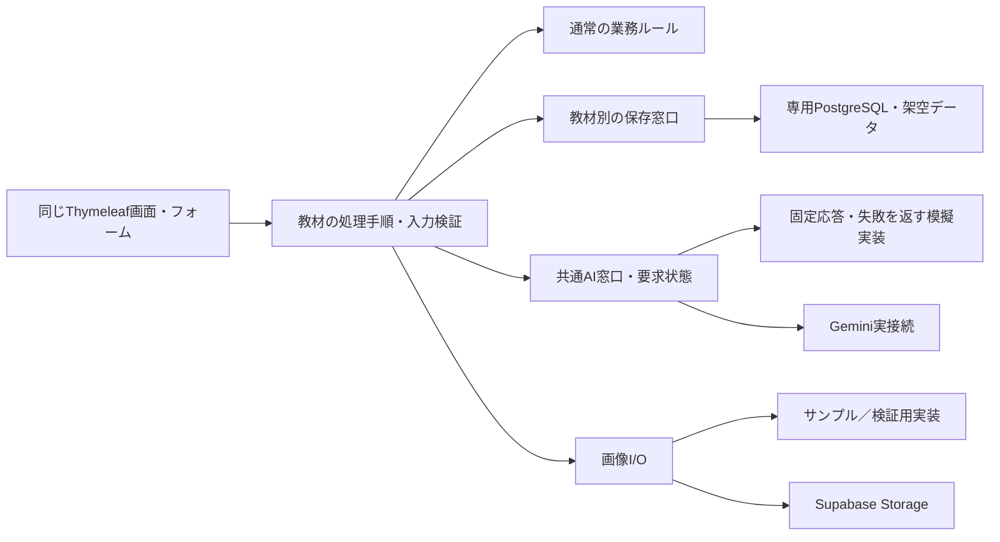

# 横展開はダミーデータで先に画面と機能を作ってしまう作戦

Web版の実装先
C:\Users\owner\.ssh\dev\ai-app-learning\src\app-learning\02-web-app-learning\skill-janken-game
C:\Users\owner\.ssh\dev\ai-app-learning\src\app-learning\02-web-app-learning\photo-diary
C:\Users\owner\.ssh\dev\ai-app-learning\src\app-learning\02-web-app-learning\online-shop
C:\Users\owner\.ssh\dev\ai-app-learning\src\app-learning\02-web-app-learning\english-trainer
C:\Users\owner\.ssh\dev\ai-app-learning\src\app-learning\02-web-app-learning\cast-evaluation

絶対に C:\Users\owner\.ssh\dev\ai-app-learning\src\app-learning\02-web-app-learning\template を丸ごと中身をコピーして
必要箇所のみ修正していく方法で土台を活かす。
他のアプリとの歪な差を最小限にする

作成日：2026-10-27

状態：調査に基づく制作計画。今回実施したのは資料・コード・公式ドキュメントの調査と本書の作成。アプリ実装、DB変更、AI送信、公開、アプリの動作試験は行っていない。

土台は [Webテンプレート](template/README.md)。提供範囲は [アプリ学習の対応表](../README.md) と [機能分担](../docs/feature-allocation.md)、共通機能の仕様は [5教材から逆算した共通仕様](template/docs/shared-foundation-requirements.md) を正とする。本書はそれらを実現する作業順の提案であり、完成済みを宣言する資料ではない。

## 1. 結論と狙い

**架空のデータと固定のAI応答で、画面・入力・計算・保存・一覧／詳細まで先につなぐ。その後、同じ画面と業務処理を使ったままAI・画像の実接続を確認する。** この進め方を採用する案とする。

静的な見本画面だけでは、保存後の表示や失敗時の操作を確かめられない。ダミー段階でも利用者が一つの作業を終えられるようにする。たとえば写真日記なら「サンプル写真を選ぶ → 固定の下書きを受け取る → 本人が手直し → 保存 → 一覧・詳細で読み返す」までを作る。

対象は、5教材を制作・説明する提供者と、自分用・業務用のアプリを試す利用者。開始時の障壁である外部接続設定と仕様の曖昧さを分け、最初に動く小さな例・サンプル・確認手順を渡す。制作中のAIには共通部品の再利用、教材固有の項目・ルール・画面の変更を依頼する。成果はアプリ数ではなく、本人が目的の操作と結果を確認できること、提供者が限られた範囲で引き渡せることで判断する。

### ダミーにするもの・実際に動かすもの

| 対象 | 先行制作での扱い |
|---|---|
| 人名・写真・商品・実績・問題・履歴 | 架空の固定データを用意する。期待結果もセットにする |
| AI応答 | 成功・失敗・待機・結果不明を返す模擬実装。実AIとして表示しない |
| 勝敗、得点、注文金額、評価集計、入力検証 | 最初から通常の処理で計算する。結果の貼り付けで済ませない |
| 保存・再読込 | 原則、専用の開発用PostgreSQLへ実際に保存する。内容だけをダミーにする |
| 写真の初期表示 | 同梱サンプルで着手できる。アップロード・保存の完了は実Storage検証後に判定する |
| 個人・管理者のアクセス制限 | ローカルの体験確認と分け、配布前に対象利用者以外が入れないことを検証する |

**「ダミーデータ」と「DB不要」は別。** 現テンプレートはユーザー・設定・Flyway等でDBを使うため、第一案は既存JDBCを再利用した「実DB＋架空データ＋模擬AI」とする。DB・Storage・AIをすべて不要にするアプリ起動モードは現状なく、その整備を5教材の着手条件にはしない。

DB準備待ちの間は、固定データを渡す画面の小さなプレビューと業務処理の単体テストを先行できる。ただし、その段階は「画面プレビュー」であり「保存機能完成」とは記録しない。完全オフライン版が必要になった場合だけ、設定・ユーザー・保存・復旧の全依存を含めて別途見積もる。

## 2. 採用方針と配布範囲を固定する

### アプリ内AIの要否

| 教材 | 01 GAS版 | 02 Web版 | AIの役割 |
|---|---|---|---|
| skill-janken-game | 不要 | 必要 | Webでセリフを事前生成・確認・採用・保存する。対戦中は保存済み文を表示。勝敗・得点・スキル効果は通常処理 |
| photo-diary | 必要 | 必要 | 写真・タグ等から日記の下書きを作る。本人が手直しして保存 |
| online-shop | 不要 | 不要 | 商品・注文・明細・金額を通常処理で扱う |
| cast-evaluation | 不要 | 不要 | 評価ルールと実績の集計・計算を通常処理で扱う |
| english-trainer | 必要 | 必要 | AIが必要な採点、テキスト会話、振り返り等を支援。決定的に採点できる部分は通常処理 |

この表は採用方針。共通テンプレートのAI疎通成功と、教材ごとのAI機能完成は別に管理する。アプリ内AI不要の教材でも、制作・学習でAIとの並走は利用する。

### 提供する基本範囲

| 教材 | 01 GAS版 | 02 Web版 | 完成後の任意の応用 |
|---|---|---|---|
| skill-janken-game | スキルなしの通常じゃんけん、勝敗・得点・履歴 | スキルありのじゃんけん、AIセリフの事前作成・採用・保存・表示 | 既存スキルの説明やセリフの雰囲気を変える |
| photo-diary | 写真・タグ・AI下書き・保存前の手直し・保存・一覧・詳細 | GASと同じ基本機能 | 旅行記・観察日記へ題材や文体を変える |
| online-shop | 商品・数量を指定する直接注文と注文・明細の保存・確認。DB・セッション・画面のどこにもカートを持たない | 画面内カートで商品・数量を確認・変更して注文。確定後の基本ルールはGASと同じ | 商品・カテゴリを身近なものへ置き換える |
| cast-evaluation | 管理者限定・単一店舗の実績入力、評価ルール、月次集計・順位 | GASと同じ基本機能 | 既存項目の配点を変え、同じサンプル実績の結果を比べる |
| english-trainer | 個人用クイズ・AI採点・テキスト会話・振り返り・学習履歴 | GASと同じ基本機能 | 問題・採点基準・会話目的を資格学習等へ変更。問題一覧・新規作成・編集画面は任意の候補 |

両基盤で完成版の配布が必要なのは、写真日記・キャスト評価・英語訓練の3教材。じゃんけんとショップには両版の完成品を揃える条件を課さず、表にある段階差を教材として用意する。

写真日記の保存後編集・削除、英語の音声、キャスト評価のルール履歴・月次結果の固定保存・複数店舗、ショップの決済・配送・在庫・永続カートは今回の制作対象に加えない。応用先の完成アプリも自動的に追加制作しない。

## 3. 調査で確認した現在地

2026-10-27のファイル確認に基づく。過去の検証件数・公開記録は各READMEの記録であり、今回の再検証結果ではない。

| 対象 | 現在地 | 計画への反映 |
|---|---|---|
| Web側の教材 | `02-web-app-learning` のアプリ用ディレクトリは現時点で `template` のみ | 教材ごとのWeb版はこれから用意する |
| 画面基盤 | Thymeleaf、admin-pico、`templates/ui`、`static/ui`、`UiContext` がある | 同じフォーム・一覧・詳細・ゲームの部品を使う |
| 保存・画像 | JDBC、Flyway、`UnitOfWork`、`ImageStore`、画像検証・後片付けがある | 業務ごとの表を追加し、保存や画像I/Oを再利用する |
| サンプル投入 | `SeedFixtures`・`SeedDataCommand` がある。許可スキーマはテンプレート用に固定 | 教材別データと投入先の安全な指定を追加する。既存コマンドを別スキーマへそのまま転用しない |
| AI | `FeaturePolicy.requireAiEnabled()` とキー読込はある。JavaのAI通信・要求状態・結果UIは未実装 | 共通仕様F1・F2に沿い、まず模擬AIと画面の契約を作る |
| 共通化の残り | ユーザー件数、画像検査、復元対象に投稿専用の依存が残る | 共通仕様F3を最初の教材で必要な分だけ整理する |
| じゃんけんUI例 | `/examples/skill-janken` と純粋な勝敗・加点関数がある | 見た目とルールの出発点。教材の永続履歴・AI完成とは別 |
| GAS写真日記 | 写真・下書き・保存のローカル実装、dummy/mock切替の設計、模擬ブラウザー検証がある | 入出力・失敗・再送の確認例を再利用する |
| GAS英語訓練 | G3までローカル実装済み。実GAS／Sheets／Geminiの受入・配布は未実施との記載 | 問題版・採点・会話・再送の仕様をWebへ引き継ぐ |
| GASキャスト評価・ショップ | README上は設計段階 | 動く完成品がある前提で移植せず、仕様からWebで実装する |
| GASじゃんけん | スキル・AIセリフの実装記録があるが、最新変更は未検証 | Webで再利用する範囲と、GASを通常じゃんけんへ簡略化する作業を分ける |

### 先に記録する不一致

- GASショップの現行README・アイディアには画面内カートが残る。今回の採用方針はGASを直接注文にすること。旧画面をそのまま複製しない。
- GASじゃんけんの既存スキル・AIを、GAS版の必須機能へ戻さない。簡略化は未実施で、既存データを初期化して済ませない。
- テンプレートREADMEには「公開URLは認証なし」とする旧説明が残る一方、現コードの `WebSecurity` と仕様には公開時Basic認証がある。公開中の版は今回未確認。分岐元を確定する際に説明・コード・実際の配備版を照合する。
- テンプレートの投稿画像は任意の1枚だが、写真日記には最大3枚の既存仕様がある。複数添付・順序・合計容量・AIへの画像入力は日記側の作業として扱う。

## 4. 実装の組み方

### 4.1 共通部と教材固有部

テンプレートの公開API・Port/Adapter（外部処理の窓口と実装）という境界を維持する。画面からダミー用と実接続用の処理を別々に呼ぶ構成にはしない。



AIの矢印は起動設定でどちらか一方を選ぶ意味。障害時に実AIから模擬AIへ自動切替しない。実接続の失敗を架空の成功で隠さない。

共通部はUI・機能許可・AI通信と要求状態・画像I/O・DBの一括保存・復旧の技術処理まで。日記、採点、カート、注文、評価、スキルを共通の `posts` や汎用JSON表へ詰め込まない。

### 4.2 モードの提案

以下は今後追加する設定案であり、現テンプレートに実装済みの起動モードではない。

| 段階 | データ・DB | AI | 画像 | 判定できること |
|---|---|---|---|---|
| 画面プレビュー | 固定データ。一時状態のみでもよい | 固定文 | 同梱サンプル | 配置・文言・遷移。永続化は未確認 |
| ダミー機能版 | 教材別の専用開発DB＋架空データ | サーバー側の模擬実装 | サンプルで開始し、必要な保存は専用Storageへ | 入力・通常計算・保存・再読込・模擬AIの操作 |
| 実接続検証版 | 同じ業務処理＋隔離した検証データ | 明示操作でGemini | 実Storage | 外部入出力、実データ形式、失敗と復旧 |
| 配布対象版 | 配布先の初期データと保存先 | AI必要教材のみ実接続 | 必要教材のみ実接続 | 公開範囲、端末、運用、引き渡し |

模擬AIでも `FeaturePolicy` の許可確認は通す。模擬モードはAPIキーなしで使え、外部へ送らない。実AIモードでキー未設定なら「未設定」を返し、模擬結果で代用しない。ショップ・キャスト評価ではAI設定・依存を必須にしない。

Springの環境別構成で実装を選択できる。具体的なプロファイル名・設定キー・起動コマンドは実装時に既存の `render`、`APP_ENVIRONMENT`、アクセス制御と整合させる。公開用設定で模擬実装が混入した場合は起動を拒否する条件を設ける。[公式：Spring Boot Profiles](https://docs.spring.io/spring-boot/reference/features/profiles.html)

### 4.3 最初に決める入出力と状態

各教材について、画面項目・必須／上限・保存単位・結果・失敗時の操作を短い表にする。固定データ、通常処理、実接続が同じ形の結果を返すようにする。

- 識別子・日時・金額・順位の表現、並び順、ページ件数、空表示を定義する。日時は固定時計で再現し、月次集計には業務日を使う。
- AIは用途・要求ID・入力照合値・指示の版・実行状態を持つ。日記・セリフの「生成」と「採用・確定保存」を分ける。
- AI成功・不正形式・禁止・未設定・利用制限・タイムアウト・結果不明を再現する。成功済み同IDは保存済み結果を返し、同ID異内容は拒否する。
- 模擬AIは通信部分だけを差し替え、要求記録・結果検証・採用処理は共通の処理を通す。
- 画面の連打防止に加え、注文・対戦・AI要求のサーバー側で同じ処理が重複しないことを確かめる。
- ローカルの模擬応答に遅延や失敗を指定する仕組みは開発者用に限定する。通常の利用画面には開発設定を混ぜない。

共通仕様のF1→F2→F3という土台完成の判定は維持する。本計画では、その完成を待つ間も、同じ契約の模擬実装で教材画面を先行する。模擬AIの完成をF1の実疎通完了には数えない。

### 4.4 ディレクトリと共通改修の扱い

教材のWeb版は、テンプレートの外に同名のディレクトリを作る案とする。

```text
02-web-app-learning/
  template/             共通基盤と小さな動作例
  photo-diary/          以下は今後作成する配置案
  cast-evaluation/
  english-trainer/
  online-shop/
  skill-janken-game/
```

一つの巨大な5教材統合アプリにはしない。各教材は必要な画面・設定だけを使い、テンプレート由来の投稿管理・CSV・ゲーム等を自動的に教材の機能へ加えない。AI使用額の既存ダミー表示も実課金集計の開発へ広げない。

最初の教材で共通修正を確かめてから、そのテンプレートのコミットを分岐元として記録する。複製時はソースと必要資産だけを対象にし、`.env`、秘密、バックアップ、実データ、ビルド出力、テスト結果はコピーしない。共通修正はテンプレートへ戻し、各教材に反映した版を記録する。共通ライブラリの新規配布や独自の自動同期基盤は今回の前提にしない。

## 5. ダミーデータと確認例

固定ID・固定日時・データ版を持つ小さなfixture（再現用データ）を各教材に置く。正常・空・境界・失敗を選べるようにし、同じ入力から期待結果を手計算できる規模を優先する。下記件数は制作の初期案で、正式な容量上限ではない。

| 教材 | 用意するデータ | まず確認する結果 |
|---|---|---|
| 写真日記 | 日記6件、タグ5種、架空画像3枚、長文・タグなし・下書き失敗 | 下書きの採用／破棄、手直しした本文の保存、画像順とタグの保持、一覧→詳細 |
| キャスト評価 | 架空キャスト3人、2か月分の実績、5項目の配点、同点・0件・重複入力 | 月の切替、期間合計後の計算、同点時の売上比較、同順位、ルール変更後の再計算 |
| 英語訓練 | 既存形式から選んだ問題6件、正答・誤答・自由記述、会話と振り返り、AI失敗 | 回答版の保持、採点結果と履歴、会話終了と振り返り。不正応答を採点済みにしない |
| ショップ | 商品6件、カテゴリ3種、販売停止商品、価格変更前後、確定・取消注文 | カート数量・合計、価格再確認、注文・明細の一括保存、履歴、取消後も明細保持 |
| じゃんけん | 既存の仲間3体・スキル3種・適性6組、勝敗3種、採用済み／未採用セリフ | 選択→決定→結果、通常の加点、履歴、採用済み文の表示、生成なしでも定型文で遊べる |

### 数値で確認する例

- ショップ：500円×2個＋800円×1個＝1,800円。確定後に商品価格を600円へ変えても、過去注文は1,800円のまま。同じ要求IDを再送しても注文は1件。
- キャスト評価：仮の売上配点を「1万円ごとに1P・有効」にし、同じ月の6,000円＋6,000円は期間合計12,000円から1Pとする。日別に切り捨てて0Pにしない。通常の初期設定では売上ポイントは無効。
- じゃんけん：勝ち2点・あいこ／負け1点に、結果と一致する基本スキルだけ+1。勝ちボーナスで勝った場合は3点、負けボーナスで負けた場合は2点。AI文言を変えても点数は変わらない。
- 写真日記：模擬下書きを採用後に本文を一文変更し、保存・再読込後も変更した本文が残る。下書きを生成しただけでは確定日記を増やさない。
- 英語訓練：問題を変更しても過去回答は回答時の問題版を参照する。AI結果不明は未確定として示し、成功した点数を作って埋めない。

### データの投入・戻し方

1. 教材・環境ごとのスキーマと、必要なStorageバケットを分ける。名前は用途が分かるものにし、許可対象を明示する。
2. まず件数・対象IDだけを確認するプレビューを用意する。通常起動ではサンプルの追加・削除を行わない。
3. 固定IDで追加を繰り返しても重複しないようにする。リセットはfixture由来の対象だけに限定し、利用者が保存したデータを巻き込まない。
4. サンプル画像も同じ由来を追跡し、他レコードから参照中の画像は削除しない。
5. 表示には「サンプルデータ」「AI応答はデモ」を明示する。実接続検証時も確認用の架空データを使う。

現行の `SeedDataCommand` と `run-local.ps1` は許可スキーマを限定しているため、教材別の実装・確認が必要。サンプル投入とFlywayによる構造変更を分け、既存マイグレーションを書き換えない。

## 6. 教材ごとに先に作る画面と機能

| 教材 | ダミー段階でつなぐ画面・操作 | 実接続・配布前の追加確認 |
|---|---|---|
| photo-diary | 新規作成、写真・タグ、下書き生成状態、採用・手直し・保存、一覧・詳細 | 複数画像の実Storage保存・読取、画像内容を含むAI入力、失敗画像・未添付画像の扱い、本人限定利用 |
| cast-evaluation | メンバー管理、実績登録・編集、評価ルール、対象月の集計・順位 | 実DBの一意制約・競合、月境界、管理者だけが操作できる公開設定。AI接続は不要 |
| english-trainer | クイズ・回答、採点・再判定、テキスト会話、振り返り、学習履歴 | 実AIの構造・内容検証、問題版・採点履歴・会話状態の保存、個人用の公開範囲 |
| online-shop | 商品一覧・詳細、画面内カート、注文確認・確定、一覧・詳細、注文全体取消 | 実DBトランザクション、価格・販売状態の再検証、再送・成否不明からの結果確認。AI接続は不要 |
| skill-janken-game | 仲間・スキル・手の選択、対戦結果・履歴、管理側の模擬セリフ生成・採用・保存 | 判定・得点・履歴の確定をサーバーで検証、実AIの事前生成、プレイ中のAI呼出しがないこと |

写真日記の複数画像は既存GAS仕様の上限・順序・失敗時の扱いを確認して移す。テンプレートの1枚投稿の制限を変えただけで完成としない。英語の採点・会話には日記と同じ「採用」操作を一律に付けず、既存教材の記録手順に合わせる。

キャスト評価の管理者限定、写真日記・英語の個人利用は、ユーザー選択Cookieでは実現できない。配布先を本人／管理者だけが使う単独環境に限定し、既存Basic認証等で満たせる範囲を検証する。複数の利用者を一つの環境で安全に分離する機能は、この計画へ暗黙に追加しない。

## 7. 実行順と作業単位

納期は現時点で確約せず、最初の一連の操作を作った実績から残作業を見積もる。全教材を同時に作り込まず、共通修正の再コピーを減らす。

| 順 | 作業 | 成果物 | 次へ進む条件 |
|---|---|---|---|
| P0 | 基準を揃える | 分岐元コミット、範囲表、既存仕様との差分、画面・入出力・保存単位 | 追加しない機能と、未確定の制約が明記されている |
| P1 | 写真日記の最小の一連の操作を作る | 共通UI＋模擬AI＋日記・タグの保存＋サンプル画像の表示 | 手直し→保存→再読込ができ、失敗しても入力が残る |
| P2 | 共通修正をテンプレートへ整理する | F1・F2の窓口と模擬経路、必要なF3整理、fixture・確認例 | 投稿例を壊さず別教材の管理・保存・画像参照を扱える。実AI未確認は残してよい |
| P3 | 残る教材のダミー機能版を順次作る | キャスト評価 → 英語 → ショップ → じゃんけんの主要操作 | 各教材の最短操作と境界・失敗の確認が通る。AI不要教材はAI設定なしで使える |
| P4 | 実接続を教材単位で完了させる | F1の実疎通、F2の実応答処理、実Storage、教材固有の受入記録 | 外部接続しても同じ画面・ルールが成立し、再送・失敗・復旧を確認 |
| P5 | 必要なGAS版を整える | Webで確かめたルール・サンプル・期待結果・解説の展開 | GAS固有の権限・排他・部分書込・公開を別途確認 |
| P6 | 配布・引き渡し | 対象版、起動・設定・操作・確認・戻し方、任意の応用例 | 必要な公開範囲・端末・保存・運用を確認し、支援範囲を合意して渡せる |

P1で写真日記を選ぶのは、既存投稿・画像UIに近く、AIの下書き・手直し・保存という再利用範囲を一度に確認できるため。ここでは日記全体や共通基盤全体の完成を待たず、小さな経路で型を確かめる。

P3の順は制作上の提案。キャスト評価でAIに依存しない計算・保存を確認し、英語でAI契約の再利用を確かめる。ショップ・じゃんけんは固有の段階差に絞る。個別教材のダミー版が通ればP4へ進めてよく、全5教材の完成待ちにはしない。

提供者の制作順は **02 Web → 01 GAS**。受講順の **01 GAS → 02 Web** は変えない。GASでは写真日記・キャスト評価・英語訓練の完成版配布を優先し、じゃんけんの通常対戦化・ショップの直接注文化は差分タスクとして扱う。Webのトランザクションや認証をGASへそのまま移せたとはみなさない。

## 8. 完了条件と検証

### 段階別の完了条件

| 段階 | 完了条件 | まだ保証しないこと |
|---|---|---|
| 設計済み | 範囲・項目・ルール・状態・期待結果が決まった | 画面や処理が動くこと |
| ダミー機能版・ローカル検証済み | 主要操作、通常計算、専用DB保存・再読込、模擬AI、失敗時の入力保持を確認 | 実AIの品質、実接続、公開先の挙動 |
| 実接続検証済み | 必要なDB・Storage・AIを使い、正常・失敗・再送・復旧を確認 | 公開環境・端末の受入、配布完了 |
| 公開・受入済み | 配布版を公開先で操作し、アクセス範囲・対象端末・保存・復旧を確認 | 応用先の完成、全端末・無期限の運用保証 |
| 配布・引き渡し済み | 対象版・手順・制限・支援終了条件を渡した | 学習者が全技術を習得したこと |

### 検証の分担

- **業務ルールの単体確認**：金額・配点・順位・勝敗・入力上限を、固定データの期待値と比較する。
- **保存とHTTPの確認**：DBの一意制約・一括保存・同ID再送・入力エラー・アクセス拒否を確認する。MockMvcは実サーバーを起動せずSpring MVCの要求処理を検査できるが、実ブラウザー・実DBの確認とは分ける。[公式：MockMvc](https://docs.spring.io/spring-framework/reference/testing/mockmvc.html)
- **ブラウザー操作**：まず390pxと1280pxで、最短操作、空表示、長文、保存中、失敗、再試行、二重押下を確認する。画像は読込完了まで、ダウンロードは中身まで見る。実スマホ受入は別記録。
- **模擬通信**：SpringサーバーからAIへ出る通信はサーバー側のAdapterで差し替える。Playwrightの通信差替えはブラウザー発のfetch等の画面確認に使う。Thymeleafのサーバー処理やサーバーからのAI送信まで差し替えたとは扱わない。[公式：Playwright Mock APIs](https://playwright.dev/docs/mock)
- **実接続の受入**：必要な教材だけ、固定の架空データで明示的に実行する。共通の短文疎通、日記の画像入力、英語の採点・会話・振り返り、セリフの生成・採用は別々に記録する。

既存テンプレートの `npm run test:unit`、`run-local.ps1 -Action test`、`npm run test:e2e` を土台にする。コピー先でコマンドが成立すること、スキーマ・ポート・Storageが分離されることを確認してから各教材のREADMEへ載せる。今存在しない `demo` 起動コマンド等を実行可能な手順として案内しない。

### 検証記録の最小書式

```text
教材／版（コミット）：
段階：設計・ダミー機能版・実接続・公開受入・配布
接続：DB実／模擬、Storage実／サンプル、AI実／模擬／不使用
データ版・確認シナリオ：
実行日時・環境・ブラウザー／端末：
操作と期待結果：
実際の結果・証跡：
未確認・不一致・次の作業：
```

## 9. 最初に着手するチェックリスト

- [ ] テンプレートの分岐元を決め、READMEとコードの公開設定の不一致を整理する。
- [ ] 写真日記の最短操作について、画面項目・保存単位・AI入出力・失敗状態を確定する。
- [ ] 架空の日記・タグ・写真・AI応答と、その期待結果を用意する。
- [ ] 教材別の開発／検証スキーマ、fixture投入・プレビュー・限定リセットを用意する。
- [ ] 投稿専用のユーザー参照・復旧対象を、日記でも使える最小の境界へ整理する。
- [ ] 共通AI窓口と模擬実装を作り、許可・成功・失敗・結果不明・再送を同じ処理で扱う。
- [ ] 写真日記の手直し→保存→一覧→詳細をPC幅・スマホ幅で確認する。
- [ ] この作業で共通化できた変更をテンプレートへ戻し、残る教材へ順次展開する。

最初の成果物は「写真日記のダミー機能版＋再利用できる最小の共通変更＋確認記録」。利用者が一つの操作を試せる状態を先に作り、実接続の不足を見える形で残す。

## 10. 参照資料

### リポジトリ内の根拠

- [アプリ学習の対応表](../README.md)、[機能分担](../docs/feature-allocation.md)：AI要否・配布範囲・任意の応用。
- [テンプレート仕様](template/テンプレート仕様.md)、[共通仕様F1〜F3](template/docs/shared-foundation-requirements.md)、[内部構造](template/docs/architecture.md)、[共通UI](template/docs/ui-foundation.md)：再利用する境界と未実装部分。
- [シード実行](template/src/main/java/com/example/webapptemplate/bootstrap/SeedDataCommand.java)、[固定データ](template/src/main/java/com/example/webapptemplate/bootstrap/internal/adapter/persistence/SeedFixtures.java)、[起動スクリプト](template/run-local.ps1)：投入先の制限と既存手順。
- [AI許可](template/src/main/java/com/example/webapptemplate/settings/FeaturePolicy.java)、[アクセス制御](template/src/main/java/com/example/webapptemplate/platform/internal/adapter/web/WebSecurity.java)、[ゲームルール例](template/src/main/resources/static/examples/janken-rules.js)：現コードで確認した実装。
- [写真日記README](../01-gas-app-learning/photo-diary/README.md)、[写真・AI仕様](../01-gas-app-learning/photo-diary/docs/specs/photo-gemini-integration.md)：複数写真・下書き・保存・模擬検証。
- [英語README](../01-gas-app-learning/english-trainer/README.md)、[G3仕様](../01-gas-app-learning/english-trainer/docs/specs/gas-trainer-v1.md)：採点・問題版・会話・再送。
- [キャスト評価README](../01-gas-app-learning/cast-evaluation/README.md)、[基本仕様](<../01-gas-app-learning/cast-evaluation/docs/tasks/01_idea/Cast Evaluation System — 基本仕様・設計.md>)：集計・配点・順位・管理者限定。
- [ショップREADME](../01-gas-app-learning/online-shop/README.md)、[注文設計](../01-gas-app-learning/online-shop/docs/tasks/01_idea/ec-shop-gasのアイディア.md)：確定価格・明細・取消。旧カート設計は採用方針との差分として読む。
- [じゃんけんREADME](../01-gas-app-learning/skill-janken-game/README.md)：基本スキル・点数・事前生成と現在の検証範囲。

公式資料は2026-10-27に参照。環境別設定・HTTP検証・ブラウザーの模擬通信という仕組みを確認したもので、本リポジトリの追加実装や互換性を検証した証拠ではない。具体的な制作順・モード・fixture件数は、上記調査に基づく本計画の提案である。
