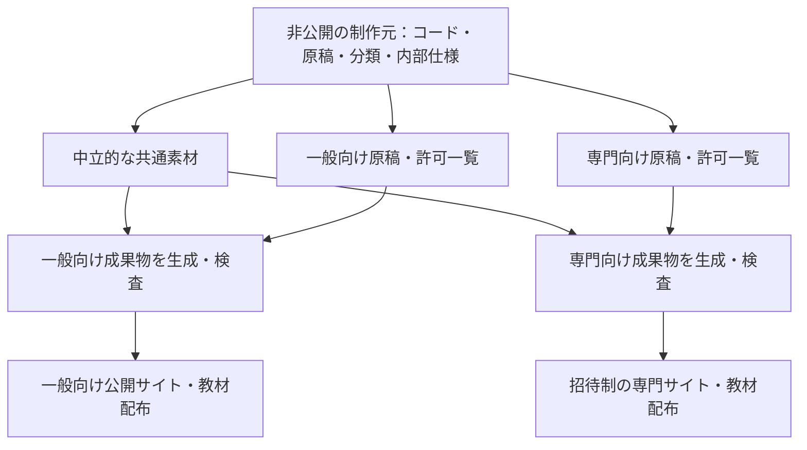

# ナイトワーク向け・一般向けの情報出口を分ける設計・管理・運用案

調査日：2026-10-28（日本時間）

状態：既存資料・コードと公式資料を確認した設計提案。サイト分離・公開停止・認証導入は未実施。

取扱い：**提供者向けの内部資料。一般向けサイト・配布教材の出力対象に含めない。**

## 1. 結論

**一般向けとナイトワーク向けで、名義・公開名を二つに分ける。ナイトワーク側の利用者には本名を伝えない。素材の制作元は共通にし、名義ごとに公開ファイル・検索・配布教材・デモ・問い合わせ導線まで分離する。**

サイトの名称だけでなく、提供者として名乗る名前、プロフィール、連絡先、配布物の著者名もこの境界に含める。一般名義と専門名義を結び付ける案内は、どちら側にも出さない。

リポジトリでは、既存アプリと仕様は現位置に維持し、`src/app-learning/docs/publication/` に共通・名義別の内部設計、`src/app-learning/publishing/` に共通・名義別の公開原稿と設定を置く。具体的なツリー、正本の分担、編集例、移行順は第6節にまとめる。

一般向けにはキャスト評価の説明・名称・URL・画像・コードを出さない。ナイトワーク向けには、写真日記を「写メ日記」の用途で紹介し、キャスト評価を店舗運営者向けに前面へ出す。同じ素材を、対象者ごとに選び直して届ける。

ただし、ナイトワーク向けサイトを誰でも見られる状態で公開する限り、一般の人も検索や共有URLから見られる。**「別サイトだから、その業種の人だけが見る」という制御はできない。**

今回の「存在を知らせたくない」を重く扱うなら、推奨は次の構成。

1. **非公開の制作元を一つ持つ。** 共通コード、教材、内部仕様、公開先の分類を管理する。
2. **一般向けサイトを独立して生成する。** 許可した一般向け素材だけを出し、ナイトワーク側への案内や切替ボタンも置かない。
3. **ナイトワーク向けは別サイトの招待制を基本案にする。** 許可した人へ写メ日記・キャスト評価を強く案内する。検索流入を使う一般公開を選ぶ場合は、第三者にも存在が分かることを受け入れる必要がある。
4. **素材の共通化と利用者データの共有は分ける。** 同じコードでも、デモ、実店舗データ、画像、利用権限は共有しない。
5. **外向きの名義と窓口を二つ持つ。** 専門側では専門用の活動名で統一し、本名・一般名義・個人用アカウントを表示や連絡に使わない。

認証付きでも、許可された人による口頭説明や画面の転送まで防ぐことはできない。達成目標は「一般向けの提供経路から専門情報を漏らさない」「専門向けの提供・連絡経路から本名や一般名義を出さない」「未許可の人へ限定内容を配信しない」と定義する。

## 2. 元の要望と対象者

依頼の要点は、非ナイトワークの人にキャスト評価を見せず存在も知らせないこと、ナイトワークの人には写メ日記・キャスト評価を推すこと、共通素材から異なるサイトへ出せないか調査すること。

追加の確定要件：**名義・公開名も二つに分け、ナイトワーク側には本名を伝えない。公開ファイル・検索・配布教材・デモ・問い合わせ導線の全体に適用する。** 具体的な二つの名前は未定のため、以下では一般名義・専門名義と呼ぶ。招待制は前述の推奨案であり、この追加要件によって採用が確定したものではない。

本書では非ナイトワーク向けを「一般向け」、ナイトワーク向けを「専門向け」と表記する。これは公開先の区分であり、IPアドレスや閲覧履歴から職業を推測して分類する仕組みではない。

| 対象 | 本人の目的・最初の支援 | 共用する素材とAIの役割 | 成果の確認 |
|---|---|---|---|
| 一般向け | 身近な記録・学習・遊び・業務から、一つの課題を試す | 中立的なコード・説明・サンプル。AIへの依頼・試行・確認の方法 | 本人の一課題を試せる。専門情報が提供経路に出ない |
| 専門向けの日記利用者 | 写真を使った日記の下書き・整理。写真・タグ・AI下書き・手直しを体験 | 写真日記の基本機能。用途別の文言・架空サンプル・AIへの指示 | 下書きを本人が確認し、保存・閲覧できる |
| 専門向けの店舗運営者 | 架空実績で入力・配点・月次集計を体験する | キャスト評価の既存ルールと教材。アプリ内AIは追加しない | 配点と結果の関係を確認できる。実店舗利用の権限制御は別途確認 |

専門向けでも、日記利用者全員に店舗の評価データを見せる設計にはしない。宣伝する相手と、実データを操作できる人は別に決める。

### 2.1 二つの名義の定義

| 対象 | 一般向け | ナイトワーク向け |
|---|---|---|
| 提供者の名義 | 一般用の公開名。ここで本名を使うかは別途決める | 専門用の活動名。本名・一般名義は出さない |
| サイト・サービスの呼び名 | 一般向けのブランド名・教材名 | 専門向けのブランド名・教材名 |
| 名刺・プロフィール | 一般名義と一般用連絡先 | 専門名義と専門用連絡先。一般側の経歴・リンクを載せない |
| 連絡 | 一般用メール・問い合わせ・必要なSNS | 専門用メール・問い合わせ・必要なSNS。個人用連絡先へ誘導しない |
| 配布・デモの表示 | 一般名義の著者・提供者・架空ユーザー | 専門名義の著者・提供者・架空ユーザー |
| 対応関係 | 外部へ掲載しない | 「別名で一般教材も提供」等の紹介をしない |

一般側から専門側を知る経路と、専門側から本名・一般側を知る経路の両方を閉じる。素材が共通でも、公開する著者・アカウント・問い合わせ先まで共通にしない。

### 2.2 本名や名義の対応を出さない運用

- 専門側のサイト、対面での自己紹介、名刺、メール、チャット、オンライン説明では専門名義に統一する。
- 送信者名、送信元アドレス、返信先、署名、自動返信、予約通知、会議の主催者表示を専門用として確認する。問い合わせフォームだけ別でも、個人メールで返信すれば分離できない。
- 共有資料の所有者・作成者・コメント・変更履歴、PDF等の著者情報、画像のメタデータ、画面録画のアカウント表示を配布前に確認する。画面共有では個人用プロフィールを開かず、専門用の作業環境を使う。
- 公開ソースの作者・コミットメール・プロフィール、パッケージの作者欄、ソースマップやエラーに含まれるローカルパスも検査対象にする。内部Git履歴を外部へそのまま渡さない。
- 同じ顔写真、アイコン、ハンドル名、自己紹介、特徴的な掲載画像や文章を両名義で使い回さない。基本コード・業務ルールを共用しても、外向きのプロフィール素材は分ける。
- 名義と本名の対応表は必要な内部管理者だけが扱う別管理とし、公開設定・素材台帳には参照IDだけを置く。本書にも実際の本名は記載しない。

これは提供者と利用者の間の表示・連絡を分ける設計。外部サービスへの登録情報と利用者に表示される情報は分けて確認する。契約・請求等の導入時には相手へ見える名義を事前確認し、本名が表示される方式を無確認で専門側へ接続しない。虚偽の本人情報を登録する運用にはしない。

名義を分けても、既に公開されたプロフィールや共通の成果物から関連を推測される可能性は残る。保証する範囲は、管理できる公開物・配布物・対応経路に本名や対応関係を出さないこととする。

## 3. 現状調査

### 3.1 ローカル資料・コードで確認したこと

| 確認箇所 | 確認結果 | 分離設計への影響 |
|---|---|---|
| [全体README](../../../README.md) | ナイトワーク用途・キャスト評価・関連教材へのリンクがある | 一般向けサイトのトップや共通配布説明へ、そのまま流用できない |
| [アプリ学習の入口](../README.md)、[GASの入口](../01-gas-app-learning/README.md)、[Webの入口](../02-web-app-learning/README.md) | 全教材の一覧・配布方針・相互参照にキャスト評価が含まれる | 個別ページだけ隠しても全体一覧から分かる |
| [横断資料の索引](README.md)、[ポートフォリオ](01_portfolio.md)、[応用カタログ](04_extension-catalog.md) | 一般用途と専門用途が同じ資料群にある | 内部管理資料と利用者へ渡す説明を分ける |
| [GASキャスト評価README](../01-gas-app-learning/cast-evaluation/README.md) | GAS版は設計段階。アプリケーション実装は未着手との記載 | 両版配布の方針と、現在配布できる版を混同しない |
| [Webキャスト評価の実装記録](../02-web-app-learning/cast-evaluation/docs/lesson-implementation.md)、[横展開記録](../02-web-app-learning/docs/rollout-status.md) | Web版の実装・公開受入記録と公開URLがある | 将来の紹介ページだけでなく既存デモも移行対象 |
| [Webキャスト評価の認可設定](../02-web-app-learning/cast-evaluation/src/main/java/com/example/webapptemplate/platform/internal/adapter/web/WebSecurity.java) | `anyRequest().permitAll()`。実装記録にもログインなしとある | 現状を「店舗管理者限定で保護されている」と説明できない |
| [Web写真日記の実装記録](../02-web-app-learning/photo-diary/docs/lesson-implementation.md) | 写真・タグ・AI下書き・手直し・保存・一覧・詳細が基本範囲。ログインなし | 写メ日記という訴求に変えても外部自動投稿や本人認証が完成するわけではない |
| [教育用テンプレートの最小構成](../02-web-app-learning/template/docs/educational-baseline.md) | 認証は外してあり、ユーザー選択は本人認証ではない | 限定公開は公開経路または専用用途の要件として設計する |

横断ポートフォリオにはGAS版を基にした「設計段階・実装未着手」という過去記録がある一方、Web個別記録には2026-10-28の公開記録がある。**版と確認日を付け、GASの状態をWebへ転記しない。** 本調査では差分を記録し、既存資料全体の改訂やアプリ変更は行っていない。

既存のキャスト評価公開URLへ匿名GETによる読み取り確認を試みたが、25秒でタイムアウトした。したがって、今回その場での公開画面・アクセス制限の実動作は確認できていない。「公開済み」は既存の記録に基づき、「認証なし」はローカルコードと実装記録に基づく。タイムアウトを非公開化の証拠とはしない。

確認範囲では、一般／専門を選別する公開マニフェストやサイト生成設定は見つからなかった。GitHub側の公開範囲、検索登録状況、過去の外部配布先は未確認。ローカルにフォルダーがあることだけで非公開とは判断しない。

### 3.2 公式資料から確認した原則

| 出典 | 原則と本件への適用 |
|---|---|
| [Google：robots.txt](https://developers.google.com/search/docs/crawling-indexing/robots/intro) | クロール制御であり秘密保持の手段ではない。専門URLを禁止するだけでは分離できない |
| [Google：noindex](https://developers.google.com/search/docs/crawling-indexing/block-indexing) | 検索索引から除く指定。Googleが読むにはクロールできる必要がある。閲覧制限の代わりにしない |
| [OWASP：Authorization](https://cheatsheetseries.owasp.org/cheatsheets/Authorization_Cheat_Sheet.html) | 明示的な許可を基準に、リクエストごとに権限を確認する。静的資産も対象。ページだけでなくAPI・画像・配布物も保護する |
| [GitHub：Pagesのアクセス制御](https://docs.github.com/en/enterprise-cloud@latest/pages/getting-started-with-github-pages/changing-the-visibility-of-your-github-pages-site) | 非公開Pagesには組織・契約等の条件がある。リポジトリをprivateにしただけで配信先も限定公開になると考えない |
| [Supabase：Storage Buckets](https://supabase.com/docs/guides/storage/buckets/fundamentals) | publicバケットのファイルはURLを知る人が取得できる。限定資料や店舗画像はprivate等で扱う |

以下は、これらの原則と現状から導いた本件向けの提案であり、実装済み仕様ではない。

## 4. 「出さない」と「見られない」を分ける

| 水準 | 達成すること | 構成・限界 |
|---|---|---|
| A：表示の切替 | 一般向け画面に表示しない | 同一サイトで非表示。HTML・JS・URL・検索・配布物から分かる可能性があり、本件には不足 |
| B：公開物の分離 | 一般向けの通常の閲覧・配布経路に専門情報を含めない | 別サイト・別出力・別検索・別配布物。ただし一般の人も専門サイトへ直接来られる |
| C：公開物と権限の分離 | 一般向け経路から出さず、未許可の人へ専門情報を配信しない | Bに加え専門側を招待制・認証付きにする。口コミや転送まで防ぐものではない |

**推奨はC。** 専門向けの紹介は、対象者との接点・個別案内・招待後のトップで行う。専門サイトを一般公開して検索流入を得る場合はBとなる。「存在秘匿」と「誰でも検索できる専門商品の宣伝」は両立しないため、公開への切替は別の運用判断にする。

一般側には「ナイトワーク版はこちら」「一部の方専用の機能」「キャスト評価は利用できません」も出さない。公開されていない教材の件数・欠番で存在を示す一覧も作らない。

## 5. 共用と分離の設計

### 5.1 全体構成



制作元の全ファイルを公開する構成にせず、許可した内容だけを取り出して公開する。

| 層 | 共用してよいもの | 分離するもの |
|---|---|---|
| 名義・プロフィール | 内部の制作体制 | 公開名、ブランド名、名刺、プロフィール、メール・SNS・会議等の外向きアカウント |
| 制作元 | 基本コード、業務ルール、中立的な解説、検証方法 | 専門用語、対象者別の説明、サンプル、案内文 |
| 公開サイト | 中立的な部品・スタイルの実装 | ドメイン、メニュー、ページ一覧、検索索引、画像、サイトマップ、OGP |
| 配布教材 | 許可されたコード・基本説明 | README、教材一覧、ZIP、PDF、動画一覧、変更履歴、リンク集 |
| デモ | 同じソース・版からの生成 | サービス、URL、保存先、接続情報、架空ユーザー、掲載画像 |
| 実利用 | 合意した業務仕様・コード | 店舗ごとのデータ・権限・画像。教材デモから切り離す |
| 運用 | 内部の版管理・不具合管理 | 問い合わせ入口、自動返信、配信対象、案内テンプレート |

サイトの区分とGAS／Webは別軸。公開先が二つになることを理由に、全アプリをさらに二重実装しない。既存のWeb→GASの制作順、GAS→Webの受講順、基本機能範囲を維持する。

### 5.2 教材ごとの扱い

| 素材 | 一般向け | 専門向け | 管理方針 |
|---|---|---|---|
| photo-diary | 「写真日記」。日常記録等の中立的な例 | 「写メ日記」。写真・文章の下書きと手直しを主な入口にする | 基本コードを共用。説明・画像・例・用途別AI指示を分離 |
| cast-evaluation | 名称・URL・画像・コード・説明を含めない | 店舗運営者向けの主な入口。実績・配点・月次集計を訴求 | 専門向け一パターンを維持。一般業種版への言い換えは作らない |
| english-trainer | 本人の目的に応じて掲載 | 希望がある場合の補助教材 | 公開許可した中立素材を再利用 |
| skill-janken-game / online-shop | 提供範囲と準備状況に合わせて掲載 | 必要な場合だけ追加案内 | 専門トップに全教材を並べる必要はない |
| 全体仕様・ポートフォリオ・本書 | 掲載しない | 利用者向けには原則掲載しない | 提供者の内部管理資料 |

写メ日記は既存photo-diaryの利用場面に合わせた説明とする。外部媒体への自動投稿、集客効果、SNS化、保存後の編集等を、紹介文を変えただけで提供済みにしない。GASとWebの完成・公開状況も別々に管理する。

## 6. 分離管理の具体案

### 6.1 推奨するフォルダー構成

**既存のアプリ・共通仕様は現在の場所に残し、名義別の内部設計を `docs/publication/`、公開用原稿と設定を `publishing/` に置く。** どちらも `src/app-learning/` の配下にまとめる。この構成を本書の具体案とし、以前のリポジトリ直下に `publishing/` を置く簡略案を置き換える。

一般用・専門用の長期ブランチや、アプリ一式を名義別にコピーした二つのツリーは作らない。共通修正を一か所で行い、名義別の差分を別ファイルで管理する。

以下は**提案する完成形**。今回作成・移動した構成ではない。新規部分は必要になったファイルから作り、空のフォルダーや仕様書を先に大量作成しない。

```text
ai-app-learning/                              # 制作元。全内容を読める内部担当者だけ
  AGENTS.md                                  # 既存：リポジトリ共通の作業ルール
  docs/
    tasks/                                   # 既存：移行作業・調査・検証の記録
  src/app-learning/
    README.md                                # 既存：全体案内。一般配布には流用しない
    01-gas-app-learning/                      # 既存：GASコードと個別仕様を維持
    02-web-app-learning/                      # 既存：Webコードと個別仕様を維持
    docs/
      README.md                              # 既存：内部の横断設計索引
      01_portfolio.md                        # 既存：全教材の内部管理
      feature-allocation.md                  # 既存：基本機能の配布方針
      ...                                    # 既存の学習設計・検証方針等
      ナイトワーク特化版の情報出口と否かで設計を分ける.md
      publication/                           # 新規：公開分離に関する内部設計だけ
        README.md                            # 正本・編集先・実装状況の索引
        separation-policy.md                 # 両名義の分離要件・共通受入条件
        general/
          site-design.md                     # 一般側の対象・構成・導線・ページ設計
          operations.md                      # 一般側の配布・問い合わせ・公開手順
        nightlife/
          site-design.md                     # 専門側の訴求・公開水準・ページ設計
          operations.md                      # 専門名義での対応・招待・公開手順
    publishing/                              # 新規：公開物の制作入力。丸ごと配信しない
      README.md                              # 内部用：生成・確認・配置方法
      catalog.yaml                           # 素材台帳。全素材の公開許可を一元管理
      common/
        content/                             # 中立的で両側へ使える本文部品
        assets/                              # 共用を確認した画像等
      general/
        publish.yaml                         # 一般用の選択ID・名義・連絡先・出力先
        content/                             # 公開ページ・配布READMEの原稿
        assets/                              # 一般用プロフィール・画像・名刺等
        samples/                             # 一般用の架空データ・教材例
      nightlife/
        publish.yaml                         # 専門用の選択ID・名義・連絡先・出力先
        content/                             # 写メ日記・キャスト評価等の公開原稿
        assets/                              # 専門用プロフィール・画像・名刺等
        samples/                             # 専門用の架空データ・教材例
      scripts/                               # 名義別生成・依存物検査・混入検査
      dist/                                  # 生成物。Git管理外・直接編集しない
        general/                             # 一般サイト・配布物だけ
        nightlife/                           # 専門サイト・配布物だけ
```

`docs/publication/general/` は「一般向けサイトを作る人の設計書」であり、一般の閲覧者へ渡す資料ではない。**フォルダー名が `general` でも公開可とは限らない。** 公開する文章は `publishing/general/content/` に別途用意する。専門側も同じ区別を守る。

`common/` は公開候補の中立素材だけを置く。全体ポートフォリオや二つの名義の関係など、「内部では共通して使うが外へ出せない資料」は既存の `docs/` または `docs/publication/` に置く。内部共通と公開共通を同じ意味にしない。

### 6.1.1 リポジトリを一つにできる条件

当面は**非公開の制作リポジトリ一つ＋公開先別の出力二つ**でよい。これは制作担当者が両名義の情報を扱ってよい場合の構成であり、フォルダー分離を閲覧権限の分離として扱わない。制作リポジトリ全体を一般利用者・専門利用者へcloneさせない。

一方の情報だけを見せる外部制作者・共同作業者が入る場合は、その人へ渡せる原稿・素材・必要なソースだけを別リポジトリに切り出す。作業ディレクトリの指定やAIへの指示文だけで、同じリポジトリ内の他方を読めなくなるとは考えない。

現在の制作リポジトリが公開されているなら、フォルダーを追加するだけでは隠せない。公開状態と履歴を確認し、非公開の制作元を用意する。公開側には審査済み成果物または選別したソースだけを置き、制作元のGit履歴をそのまま移さない。

一般教材のソース公開が必要な場合も、許可ファイルだけの配布リポジトリを用意できる。修正は制作元へ戻して再生成し、配布側を第二の正本にしない。リポジトリの公開範囲とウェブサイトの公開範囲は個別に確認する。[GitHub公式](https://docs.github.com/en/enterprise-cloud@latest/pages/getting-started-with-github-pages/changing-the-visibility-of-your-github-pages-site)

### 6.1.2 正本をどこに持つか

以下のパスは、特記がなければ `src/app-learning/` からの相対パス。

| 判断する内容 | 正本 | 他の場所での扱い |
|---|---|---|
| 教材全体の目的・基本範囲 | 既存の `README.md`・`docs/feature-allocation.md` 等 | 名義別設計は参照する。基本仕様を独自に増やさない |
| 個別アプリの機能・DB・操作・検証状態 | 各GAS／WebアプリのREADME・指定された仕様書 | 名義別フォルダーへ複製しない |
| 二名義の分離・本名非開示・共通受入条件 | 移行後は `docs/publication/separation-policy.md` | 名義別の設計・手順から参照する |
| 対象者・訴求・画面構成・導線 | `docs/publication/{general,nightlife}/site-design.md` | 公開原稿はこの設計に従う |
| 名義別の問い合わせ・配布・公開運用 | `docs/publication/{general,nightlife}/operations.md` | 共通ポリシーを全文再掲せず、各名義の具体手順を書く |
| 外に出す文章・画像・サンプル | `publishing/common/` と各名義の `content/`・`assets/`・`samples/` | 公開側・生成物を直接編集しない |
| 素材ごとの公開許可・依存物 | `publishing/catalog.yaml` | 設計書の一覧は説明用。生成時の判定元を二重に持たない |
| 使用する素材ID・公開用名義・連絡先 | 各名義の `publish.yaml` | 原稿へ連絡先等を大量に直書きしない |
| 一回の移行・修正・公開確認の記録 | リポジトリ直下の既存 `docs/tasks/` | タスクメモを仕様の正本にしない |
| 本名との対応・秘密値・実顧客情報 | リポジトリ外のアクセス制限された管理先 | Gitに入れず、公開設定にも転記しない |

本書は現在の検討内容をまとめる指定文書として維持する。実際に分割するときは、分離要件を `separation-policy.md` へ移し、本書の重複する確定要件は要約と参照へ置き換える。二つの文書をそれぞれ独立して更新する運用にはしない。**現時点では分割先は未作成なので、本書が分離案の参照元である。**

### 6.2 素材台帳

コード・文書・画像・動画・添付を分類する。最初は小さなYAMLや表でよく、CMSや専用管理アプリは必須にしない。

具体的な置き場所は `src/app-learning/publishing/catalog.yaml`。名義別の `publish.yaml` はここに登録したIDを選ぶ。公開できるのは「台帳でその名義に許可され、かつ名義別設定で選択された素材」の共通部分だけとし、名義別設定から台帳の許可を広げられないようにする。

| 項目 | 意味 |
|---|---|
| `id` | 素材の内部ID |
| `source` / `source_revision` | 正本のファイル・版 |
| `allowed_sites` | `general` / `nightlife` の明示的な許可。空・未設定なら公開しない |
| `access` | `public` / `invited` / `internal`。公開先とは独立したアクセス範囲 |
| `variant` | 公開先別の表示名・説明・サンプル・画像 |
| `identity_profile_id` | 公開先に対応する名義・著者表示・問い合わせ先の設定ID。本名や二名義の対応表は入れない |
| `dependencies` | 使用する画像・添付・関連ページ・コード |
| `owner` / `reviewed_at` | 責任者と確認日 |
| `release_status` | 設計・実装・ローカル確認・公開受入など、版ごとの状態 |

設定例。既存の生成処理が読み込む設定ではない。

`identity_profile_id` は対応する名義の `publish.yaml` 内の公開用設定を参照する。設定全体や全素材台帳をブラウザーへ配信せず、出力に必要な公開名・著者表示・連絡先だけを生成時に取り出す。

```yaml
items:
  - id: photo-diary
    allowed_sites: [general, nightlife]
    variants:
      general:
        title: 写真日記
        access: public
      nightlife:
        title: 写メ日記
        access: invited
  - id: cast-evaluation
    allowed_sites: [nightlife]
    variants:
      nightlife:
        title: キャスト評価
        access: invited
  - id: internal-portfolio
    allowed_sites: []
    access: internal
```

### 6.3 出力ルール

1. 許可一覧から対象を選ぶ。「全件を出した後に禁止対象を消す」作り方にしない。
2. 画像・添付・関連リンク等の依存物も判定する。一般ページが専門素材を参照したら生成を失敗させる。
3. 専門リンクを消しても説明が残る場合は一般向け原稿として書き直す。自動置換だけで審査完了にしない。
4. 検索索引・サイトマップ・RSS・OGP・構造化データ・配布物も、選別済み素材だけから生成する。
5. 一般側のHTML・JS・JSONへ全教材カタログや専門設定を送らない。ブラウザー側の非表示を分離境界にしない。
6. 配布ファイルを列挙し、全体README、内部仕様、`.git`、作業ログ、テスト画像、DB初期データ、不要な依存物が混ざらないようにする。ZIP・JAR等は展開して中身も検査する。必要なライセンス表記は保持する。
7. 元の版、公開先、採用ファイル一覧、成果物ハッシュを内部リリース記録へ保存する。
8. 各公開先の名義設定から、著者・提供者・連絡先を生成する。設定未登録時は本名や一般名義へ代替せず、生成を止める。
9. 専門成果物では本名・一般名義・個人メール・一般用アカウントの混入を検査する。照合に使う非公開情報や検出結果の原文は、公開設定・配布物・公開ログへ入れない。

禁止語検索は補助に使う。単語がなくても画像・URL・リンクから分かるため、許可一覧と実出力の照合を主とする。

### 6.4 設計書と公開原稿の書き方

内部の `site-design.md` には、対象者とゴール、最初に見せる内容、ページ一覧と導線、掲載する教材、必要な公開制限、受入条件を書く。専門側には写メ日記・キャスト評価の訴求と本名非開示を記し、一般側には一般利用者の目的に合う構成を記す。個別アプリのDB設計や業務ルールは参照で済ませる。

`operations.md` には、使用する名義設定のID、問い合わせ受付から返信までの手順、配布物の選び方、公開・停止・差戻しの手順を書く。パスワードや本名を手順書へ埋め込まない。

公開用の `content/` には、その名義の利用者へそのまま読ませられる文章だけを書く。「内部向け注記」「専門側から転用」「一般側には見せない」等の編集メモは内部設計へ置く。配布READMEも、既存の全体READMEをコピーせず、選択した教材だけを案内する原稿を作る。

ファイルの先頭には少なくとも、文書の状態、管理対象、更新日を付ける。内部設計には `visibility: internal`、公開候補の原稿には `audience: general` 等を付けてもよいが、**この表示だけで公開許可とはしない。** 正式な公開判定は素材台帳と名義別設定で行う。

共通本文は参照・差込みで再利用する。公開先ごとに変えるのは導入、利用例、教材の表示名、画像、問い合わせ先等。本文の手動コピーを両側で編集し続ける運用を避ける。専門用途を含む段落が必要になったら、共通本文へ条件付きで混ぜず、専門用原稿に置く。

### 6.5 変更した内容から編集先を決める

| 変更例 | 最初に編集する場所 | 連動して確認する場所 |
|---|---|---|
| 写真日記の保存処理・上限を変える | 対象アプリのコード・仕様 | 両名義の説明・サンプル・受入条件。GAS／Webの反映状態を区別 |
| 写メ日記の紹介を改善する | `publishing/nightlife/content/` | 必要なら専門側の `site-design.md`。一般側の原稿は変更不要 |
| 専門名義・問い合わせ先を変える | `publishing/nightlife/publish.yaml` | 専門側のページ・名刺・署名・添付・返信テンプレート |
| キャスト評価を専門トップへ追加する | 専門側の `site-design.md` と原稿 | `catalog.yaml` の許可、専門側 `publish.yaml` の選択。一般側に追加しない |
| 一般向けの共通説明を両方で使う | `publishing/common/content/` | 両名義に適切か確認し、台帳で両方への許可を明示 |
| 分離ルールを変える | 移行後の `separation-policy.md` | 両名義の設計・台帳・生成検査・運用手順 |
| 公開時に不具合が出た | リポジトリ直下 `docs/tasks/` に事実を記録 | 原因となった正本を修正して再生成。`dist/`だけ直さない |

同じ変更で影響する正本・原稿・設定を一組の変更として扱う。機能の仕様変更と公開文面の更新が別時期になる場合は、公開文面がどの実装版に対応するかを記録し、未公開機能を提供済みとして先に案内しない。

### 6.6 既存資料をどう整理するか

| 現在の資料・資産 | 当面の扱い | 分離後に用意するもの |
|---|---|---|
| ルート・アプリ学習・GAS・Webの全体README | 現位置で内部の全体案内として使用。一般配布から除外 | 名義別の公開トップ・教材一覧・配布README |
| `docs/01_portfolio.md`、学習設計、機能分担、応用カタログ | 現位置を共通方針の正本として維持。全体公開しない | 必要な説明を中立の共通本文または名義別原稿として編集 |
| 各アプリのREADME・DB設計・実装記録 | 現位置を維持。名義別フォルダーへコピーしない | 利用者に必要な操作説明だけを公開用に編集 |
| `cast-evaluation` のコード・設計 | 現位置を維持。一般用成果物へ出さない | 専門用の説明・配布設定・架空サンプル |
| `photo-diary` のコード・設計 | 共通の機能として維持 | 一般用「写真日記」と専門用「写メ日記」の導入・例・画像 |
| 本書 | 指定の場所を維持。内部資料として扱う | 実装移行時に確定要件と名義別設計を分割し、本書は判断理由・概要・参照を残す |

既存READMEは現在のリポジトリ方針では学習者向けの入口でもある。分離を実装する際は、この位置付けの変更を `AGENTS.md`・ルートREADME・関連索引へ同時に反映する。今回の提案を書いただけで、それらの既存ルールが変更済みになったとは扱わない。

### 6.7 最小限の着手順

最初に追加するのは次の8ファイルを目安とする。フォルダー構成案の全ファイルを一度に作る必要はない。

1. `docs/publication/README.md`：編集先と正本の案内。
2. `docs/publication/separation-policy.md`：本書の確定した分離要件を移す。
3. `docs/publication/general/site-design.md`：一般側の構成と公開候補。
4. `docs/publication/nightlife/site-design.md`：専門側の構成・名義・公開水準。
5. `publishing/README.md`：生成方法と未実装事項。未作成のコマンドを実行可能として書かない。
6. `publishing/catalog.yaml`：最初に扱う少数の素材の登録。
7. `publishing/general/publish.yaml`：一般側の選択と公開用設定。
8. `publishing/nightlife/publish.yaml`：専門側の選択と公開用設定。

次に、両側のトップと写真日記の紹介、専門側のキャスト評価紹介を作る。共通本文は実際に両側で使う部分が見えた段階で抽出する。続いて生成・検査・公開手順を実装し、具体手順が固まったら各 `operations.md` に残す。`publishing/dist/` はGit管理外にする設定もその時点で追加する。

名義が未定の間は仮の識別IDで内部設計を進めてよいが、公開名や連絡先の未設定を本名で補完しない。公開工程は未設定のまま通さない。

### 6.8 運用を崩さないためのルール

- `docs/` は設計・判断・内部手順、`publishing/*/content/` は外向き原稿、`publish.yaml` は名義別の選択・設定、`dist/` は生成結果と役割を固定する。
- `general` と `nightlife` の原稿は互いを直接参照しない。再利用が必要な中立部分だけを `common` へ抽出する。内部設計から他の内部資料を参照することはできる。
- 公開文書のリンクは、同じ公開先の生成済みページ・添付へ変換する。`../../docs/` や制作元リポジトリのURLへリンクしたまま公開しない。
- `publishing/` 全体、制作リポジトリ全体、素材台帳、生成スクリプト、内部設計をウェブの公開ルートに指定しない。配信するのは検査済みの一方の `dist` だけとする。
- サイト構成用の文書・原稿の差分だけなら、フォルダー・ファイルを分ければよい。機能自体の差分が生じた場合は個別アプリの仕様として判断し、コピーで分岐させる前に共用可能な範囲を決める。
- 移行時に既存 `AGENTS.md` へ公開境界の短いルールを追加し、必要なら `publishing/AGENTS.md` に生成・検査手順を置く。ルール文書は補助であり、実際の混入防止は生成時の検査で行う。
- 一方だけを扱う外部担当者やAI作業環境には、必要なファイルだけを渡す。制作元全体にアクセスできる環境を、フォルダー名だけで隔離したことにしない。

この構成への実ファイルの移動、フォルダー作成、公開処理の実装、既存の管理ルールの変更は本書の更新では行っていない。

## 7. 配信・認証・データの境界

### 7.1 公開先

一般向けと専門向けは別ドメインを基本案にする。別サブドメインでも出力分離はできるが、同じ親ドメインでは関連が推測されやすい。別ドメインも認証の代わりにはならない。

- 別のサービス・配置先を使い、一般側に専門ファイルを置かない。
- 存在しない一般側URLは通常の404とし、専門側へ転送しない。エラー画面・フッターも分離する。
- 一般側にブランド切替・姉妹サイト一覧・全教材一覧を置かない。
- Cookieやブラウザー保存領域を必要以上に共有せず、専門情報を一般側の検索候補やキャッシュへ混ぜない。
- CDNはホストを区別してキャッシュする。認証が必要な内容には共有キャッシュを使わせない設定を行う。
- 独自ドメインに加え、事業者の標準URL、プレビュー、旧URL、配信元への直アクセスも確認する。

紹介サイトは静的HTML中心で足りる。既存Renderを使う場合も別の配信単位にする。Renderには標準URLやプレビューの仕組みがあるため、そこも公開経路として管理する。[Render公式：Static Sites](https://render.com/docs/static-sites)

静的配信サービスを選ぶだけで招待制にはならない。C案は認証を強制できる配信経路を選び、元の配信先への直接アクセスでも迂回できないことを確認する。認証を強制できない構成はC案の専門サイトには採用しない。

### 7.2 閲覧権限

招待は提供者が案内対象を確認して付与する。URLの長さ、業種の自己申告、紹介元、URLパラメーター、CORSだけを閲覧許可の根拠にしない。

専門サイトを認証付きにしても、リンク先デモが無認証で公開されていれば機能と存在が分かる。C案は紹介ページ・検索・画像・PDF・ZIP・デモを同じ範囲で保護し、各リクエストで権限を確認する。[OWASP公式](https://cheatsheetseries.owasp.org/cheatsheets/Authorization_Cheat_Sheet.html)

現行Web教材のユーザー選択は認証ではない。共通テンプレートに一律で認証・監査DBを再追加する要件にはしない。限定公開は配信側で扱うか、実店舗へ導入する個別用途の要件として設計する。

### 7.3 データ

| 環境 | データと境界 |
|---|---|
| 一般デモ | 中立的な架空データだけ。専門情報・実店舗データを入れない |
| 専門デモ | 専門用途の架空データだけ。C案では招待者のみ閲覧 |
| 実店舗利用 | 実データは別環境。本人確認・権限・他店舗からの分離を別途設計・検証 |

スキーマ名・バケット名を分けるだけで権限分離が完成するわけではない。その接続資格で読める範囲まで確認する。実利用の分離に必要なら別プロジェクト・別資格情報も検討するが、教材全体を多店舗システムへ改修する計画にはしない。

限定画像・資料はprivateバケット等で扱う。Supabaseのpublicバケットは取得時のアクセス制限を回避するため、サイトだけ認証しても画像は守れない。署名付きURLも期限内は転送され得るので、有効期間を必要な範囲に絞る。[Supabase公式](https://supabase.com/docs/guides/storage/buckets/fundamentals)

## 8. 情報が混ざりやすい出口

| 出口 | 対策 |
|---|---|
| 名刺・プロフィール・検索用の著者情報 | 名義・顔写真・自己紹介・関連アカウントを分け、両名義を結ぶリンクや対応表を出さない |
| メニュー・関連記事・フッター | 公開先別の一覧から生成する |
| サイト内検索・候補辞書 | 索引・検索API・候補を分ける |
| HTML・JS・JSON・ソースマップ | 非表示カードや専門設定も一般成果物に含めない |
| 画像・PDF・動画 | ファイル名、画面内文字、字幕、メタデータまで確認する |
| OGP・構造化データ・サイトマップ | 選別済み内容から生成し、SNS等での表示も確認する |
| ZIP・ソース・Git履歴 | 許可ファイルだけを配布し、制作元全体のcloneを案内しない |
| デモ・管理画面・API | 直接アクセスを含めて分離・制限する |
| Storage・CDN・標準URL・プレビュー | 本番ドメイン以外の迂回経路も管理する |
| 問い合わせ・自動返信・営業資料 | 受付元の区分を保持し、送信者名・送信元・返信先・署名・添付まで対応する名義に統一する |
| 共有ファイル・会議・画面共有 | 所有者・著者・コメント・主催者・ログイン中プロフィールに本名や反対側の名義が出ないか確認する |
| AIによる説明・検索回答 | 一般向け生成には許可済み資料だけを渡す。全資料を渡して指示文だけで隠さない |
| 更新通知・障害情報 | 専門機能の情報を全員へ配信せず、公開先別の変更履歴を持つ |

新しいチャットボットや問い合わせシステムを導入する意味ではない。既存の案内手段にも同じ分類を適用する。

noindexは検索対策の補助で、アクセス制限ではない。またrobots.txtでクロールを禁止すると、Googleがnoindexを読めなくなる場合がある。C案では認証を優先する。robots.txtに隠したい機能のパスを列挙する運用も避ける。[Google：robots.txt](https://developers.google.com/search/docs/crawling-indexing/robots/intro)、[Google：noindex](https://developers.google.com/search/docs/crawling-indexing/block-indexing)

## 9. 更新・公開・日常運用

### 9.1 一回の更新の流れ

1. 制作元で変更し、共通変更か公開先固有かを記録する。
2. 素材台帳の許可・依存物・版の状態を更新する。未分類は出力しない。
   公開先に対応する名義・プロフィール・問い合わせ先も確認し、専門側に本名や一般側の設定を引き継がない。
3. 共通機能の変更は両公開先への影響を確認する。文言だけの変更でアプリ全体の試験を増やさない。
4. 公開先別に生成し、ファイル一覧・文言・リンク・検索・配布物を検査する。
5. 一般側は匿名、専門側は未認証・許可済み・許可なしの状態で確認する。プレビュー自体も制限する。
6. 公開先・成果物の版・許可範囲を確認して配置する。未審査の素材がpushだけで公開されないようにする。
7. 公開後に経路を確認して記録する。公開先ごとに直前の安全な版へ戻せるようにする。

### 9.2 持つ記録と担当

| 記録 | 最低限残す内容 |
|---|---|
| 素材台帳 | 正本、公開先、アクセス範囲、依存物、確認日 |
| 名義別の公開設定 | 公開名、ブランド名、公開用著者名、連絡先、外向きアカウント。実際の本名との対応は別の非公開管理 |
| リリース記録 | 元の版、成果物、公開先、確認者、日時、戻し先 |
| 案内先 | どちらを案内したか、招待・停止状態。必要以上の属性は集めない |
| 混入・不具合記録 | URL・配布物、影響範囲、原因、回収・修正、再発防止 |

素材担当が分類し、公開担当が成果物と配置先を確認する。一人運用でも制作と公開確認を別工程として記録する。毎回の公開時に検査し、月1回程度を目安に検索結果・旧リンク・配布物・招待権限を点検する。

共通修正は正本へ一度反映して必要な公開先を再生成する。専門側だけの文言変更で一般側を機械的に更新しない。

## 10. 既存環境からの移行順

### 優先1：現在の出口を棚卸しする

- 二つの公開名・ブランド・連絡先を定め、専門側に本名や一般名義が出る経路を棚卸しする。実名の収集や本書への転記は行わない。
- GitHubの公開範囲、README、履歴、Release、ZIP、PDF、動画、共有資料を確認する。
- 既存キャスト評価デモ、標準URL、写真日記のサンプル、紹介ページを一覧化する。
- 検索結果と過去に渡した教材・リンクを確認する。検索で見つからないことを未公開の証明にしない。
- 専門側をBまたはCのどちらにするか決める。本書はCを推奨する。

### 優先2：内部正本と公開原稿を分ける

- 名義別のプロフィール・名刺・署名・問い合わせ先・外向きアカウントを用意する。既存の個人アカウントで専門向け対応を始めない。
- 全体README・横断資料を内部管理用とし、一般向けトップ・教材一覧・配布READMEを用意する。
- 写真日記の中立サンプルと写メ日記サンプルを分ける。
- キャスト評価を専門、本書を内部に分類する。
- 大規模なソース移動の前に許可一覧を作り、少数ページから始める。

### 優先3：二つの出力と検査を作る

- 成果物、検索索引、サイトマップ、添付、配布ZIPを公開先別に生成する。
- 一般側への混入、リンク違反、未分類、未許可の依存物があれば公開を止める。

### 優先4：公開先と既存URLを整理する

- 別の配置先・ドメインを用意し、C案なら紹介・教材・デモ・添付を一体で制限する。
- 既存公開デモを停止・保護・移転のどれで扱うか決める。リンク削除だけで完了にしない。
- 旧URLに専門商品の名前や新URLを教える案内を残さない。非公開化・404／410等を使い分け、許可済み利用者には個別に新入口を案内する。
- 一般向け経路と成果物に専門情報が残っていないことを確認して切り替える。

### 優先5：過去の公開・配布を扱う

第三者へ渡ったコピーや検索結果は、サイトを分けただけでは消えない。管理できる配布先の差替え、旧版の公開停止、必要な検索結果削除対応を行う。GitHubも、公開リポジトリを非公開にしても既存の公開forkは非公開化されないと説明している。過去に知られた事実を元に戻せるとは扱わない。[GitHub公式：公開範囲変更の影響](https://docs.github.com/en/repositories/managing-your-repositorys-settings-and-features/managing-repository-settings/setting-repository-visibility)

今回の作業は調査文書の作成まで。デモ停止、ドメイン変更、非公開化、履歴変更、利用者への連絡は実施していない。

## 11. 公開前の受入条件

| 確認 | 合格条件 |
|---|---|
| 二つの名義 | 各サイト・名刺・プロフィール・著者表示が対応する名義で統一され、相互の対応関係を出していない |
| 専門側の本名非開示 | 公開物・配布物・デモ・ファイル属性・履歴・画面共有に本名、一般名義、個人用連絡先が出ない |
| 専門側の問い合わせ対応 | 受付から返信・添付・予約・オンライン説明まで、相手に見える名義と連絡先が専門用で統一される |
| 一般側の画面 | トップ・一覧・詳細・関連記事・404・フッターに専門情報や専門側への案内がない |
| 一般側の取得物 | HTML・JS・JSON・検索索引・ソースマップ・画像・添付・圧縮物に専門素材がない |
| 一般側のリンク | 内部正本、全体リポジトリ、専門サイト・専門デモへのリンクがない |
| 直接指定 | 専門パス・教材ID・クエリを指定しても、一般側から内容や存在を示す案内を返さない |
| 検索・SNS表示 | タイトル・説明・OGP・構造化データ・サイトマップが公開先と一致する |
| 許可一覧 | 新規素材は未分類で出力されず、依存する画像・添付も検査される |
| 専門側の未認証アクセス（C） | ページ・API・画像・配布物・デモを取得できない。認証前画面にも商品詳細を出さない |
| 専門側の認可（C） | 一般利用者や権限を取り消した利用者が専門情報を取得できない |
| 迂回経路（C） | 標準URL・プレビュー・配信元・Storageへの直アクセスで迂回できない |
| キャッシュ（C） | 許可済み利用者が見た内容を、未許可利用者へCDN等が返さない |
| 実データ | デモは架空データのみ。店舗の評価・写真は別環境・別権限 |
| 配布・案内 | README・ZIP・動画・返信・更新通知も公開先別になっている |
| 版の状態 | GAS／Webの実装・確認・公開状態を区別し、未完成品を完成版として案内しない |
| 復旧 | 問題の成果物を停止・差替えでき、直前の安全な版と影響先が分かる |

混入時は該当公開物を停止し、配布先・検索・CDN・添付を含めて影響を確認する。修正後は成果物全体を再検査する。戻し先にも混入がある場合は、その版への単純なロールバックを行わない。

## 12. 推奨判断と残る決定事項

| 項目 | 推奨 |
|---|---|
| 名義（確定要件） | 一般名義・専門名義を分ける。ナイトワーク側の利用者へ本名を伝えない |
| 共通化 | 基本コード・業務ルール・中立解説・検証方法 |
| 分離 | 名義・プロフィール・連絡先・外向きアカウント・公開原稿・画像・成果物・検索・教材配布・デモ・問い合わせ導線 |
| 制作元 | 非公開の正本一つ。許可一覧から公開物を生成 |
| フォルダー管理 | 既存アプリの仕様は現位置、内部の公開設計は `docs/publication/`、公開原稿・設定は `publishing/`。詳細は第6節 |
| 一般サイト | 専門情報を出力しない独立サイト |
| 専門サイト | 別サイトの招待制を基本に、写メ日記・キャスト評価を推す |
| キャスト評価 | 専門向け一パターンを維持し、一般向け別名製品を作らない |
| 写真日記 | 基本コードを共有し、説明・サンプル・デモを分ける |
| 技術基盤 | 既存のSpring Boot・Thymeleaf・Render・Supabase方針を維持。新CMS等を必須にしない |
| 最初の実装範囲 | 原稿・許可一覧・二系統の出力・混入検査・必要な公開制限 |

名義を二つに分けることと専門側に本名を伝えないことは、ユーザー指定の確定要件。具体的な公開名・ブランド名・連絡先は未定。加えて実装前に決めるのは、専門側を招待制にするか一般公開にするか、使うドメイン、現行リポジトリとデモの公開範囲、既存利用者への移行方法。認証方式・契約の細部は、この公開水準と既存環境を確認して選ぶ。

**作る場所は共通、名乗る名前・渡す内容・連絡する窓口は分離する。** 一般向けに全素材を渡してから見せ方だけを変えることや、専門サイトだけ別名にして個人用アカウントで対応することでは、今回の要望を満たせない。
