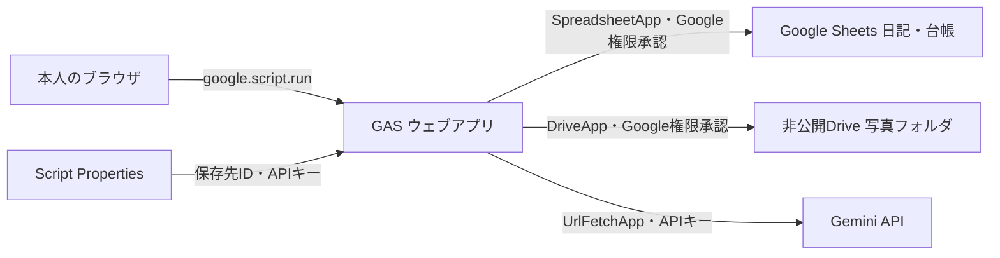

# GAS・Gemini・Google Drive 認証連携方法マニュアル

作成日：2026-10-25（Asia/Tokyo）  
対象：ai-photo-diary（GAS日記）  
用途：後日作成する詳細マニュアルと操作動画の原稿・素材台帳。

現行ソース、提供済みスクリーンショットの内容を記録した既存資料、Google公式資料を照合して作成した。2026-10-24の成功記録と、今回の実装照合を区別する。今回、実アカウントの認証・API実行・デプロイは行っていない。

スクショ原本は今回の会話・プロジェクト内の画像ファイルから直接参照できていない。受領済み証跡は既存記録から利用し、後日の編集時に原本を素材台帳へ紐づける。画面のボタン名・配置は撮影時の表示と最終照合する。

## 1. 各機能と連携の役割

| 機能 | 現在の動作 |
|---|---|
| 日記一覧・詳細 | 日記とキーワードを表示し、キーワードで絞り込む |
| 日記作成 | タイトル・本文・写真・キーワードを保存。既存日記の編集・削除はMVP対象外 |
| 写真アップロード | JPEG/PNGの静止画を縮小し、非公開Driveフォルダへ保存 |
| 複数写真 | 最大3枚。並び替え・失敗分再送に対応。先頭を代表画像にする |
| 写真の再表示 | GASが管理対象画像を読み、アプリへ返す。公開共有URLは使わない |
| Gemini下書き | キーワードや登録済み実画像からタイトル・本文を生成し、保存前に手直しできる |
| 文体設定 | `env/diary-preferences.md`の「文体」「内容のルール」の箇条書きをビルドして利用 |
| 未添付画像整理 | 24時間以上経過し日記から未参照の候補を確認し、個別にゴミ箱へ移動 |

画像の上限は元画像10MiB・4000万画素以下、長辺1600px以下へ縮小、保存用1枚1MiB以下・合計3MiB以下。ブラウザでJPEGへ再符号化する。動画・GIF・APNGなどは対象外。これは本アプリの制約で、Google全体の上限ではない。



## 2. 認証の種類と必要なリソース

| 認証・設定 | 何のために行うか | 確認する場所 |
|---|---|---|
| GASのGoogle権限承認 | 実行アカウントによるDrive・Sheets等へのアクセス | GAS診断の実行ログ |
| Gemini APIキー | キーの所属プロジェクトでのGemini利用 | `testGeminiHello`の成功ログ |
| ウェブアプリ公開設定 | 誰がアクセスでき、誰の権限で動くか | デプロイ設定・公開画面 |
| claspログイン | ローカルPCからGASソースを反映 | 開発環境の接続確認 |

同じGoogleアカウントでログインしても、GASのDrive承認とGeminiキー設定はそれぞれ必要。claspやDriveコネクタで認証できても、GAS実行主体のDrive承認成功とは判断しない。

GASは初回実行時などにGoogleサービスへの承認を要求する。現行manifestに`oauthScopes`の明示指定はないため、実際の要求権限は承認画面で確認する。[Google公式：サービスの承認](https://developers.google.com/apps-script/guides/services/authorization)

| リソース | 用意・確認するもの |
|---|---|
| Googleアカウント | GAS実行者とDriveフォルダ所有者を揃える |
| Google SheetsとGAS | 対象スプレッドシートに紐づく本アプリ。`getActiveSpreadsheet()`を使用するため、独立GASだけでは不足 |
| Drive写真フォルダ | 本人所有・非公開・追加共有なし。IDを`PHOTO_FOLDER_ID`へ登録 |
| AI Studio / Cloudプロジェクト | キーの所属先・利用枠・制限を確認 |
| Gemini APIキー | GASの`GEMINI_API_KEY`へ保存 |

### 「リソース追加」「サービス追加」の整理

本アプリのDrive処理は標準の`DriveApp`を使用する。現行manifestに`enabledAdvancedServices`はなく、GASの「サービス」から高度なDriveサービスを追加する操作は必須ではない。Geminiも`UrlFetchApp`からREST APIを呼ぶため、Gemini用ライブラリの追加は不要。

スクショに追加操作がある場合は、「Driveフォルダ作成」「AI Studioへのプロジェクト取り込み」「GASの高度なサービス追加」のどれかを特定して説明する。

将来`Drive.Files`など高度なサービスを利用するコードへ変更した場合は、GASエディタの「サービス」横から対象サービスを追加する。標準Cloudプロジェクトを使う場合は対応APIの有効化も必要。これは現行の必須手順には含めない。[Google公式：高度なサービス](https://developers.google.com/apps-script/guides/services/advanced)

GASに紐づくCloudプロジェクトとGeminiキーの所属プロジェクトは役割が異なる。名前が同じでも同一とは断定しない。本実装では、GAS側のCloudプロジェクト切り替え、OAuthクライアントIDの手入力、サービスアカウントJSONの登録を必須とする設定項目はない。

## 3. 作業前の確認

1. 対象スプレッドシートの「拡張機能」→「Apps Script」から目的のGASを開く。
2. Googleアカウントを確認する。GAS実行者・デプロイ実行者・Driveフォルダ所有者を揃える。
3. `checkDriveSetup`、`checkGeminiSetup`、`testGeminiHello`、`testPhotoDiaryFlow`が配置済みか確認する。
4. 既存環境では登録済みの設定とフォルダを確認する。説明のためだけに作り直さない。

新環境への展開では、スプレッドシートに紐づくGASへコードを配置し、clasp接続先とデプロイ先を新環境へ合わせる。コード配置の前提は[プロジェクトREADME](../../../README.md)を参照する。

## 4. Drive保存先の準備と認証（P1）

### 4.1 写真フォルダを用意する

1. GAS実行アカウントでGoogle Driveを開く。
2. 新環境ならマイドライブに写真専用フォルダを作成する。名前の例：`ai-photo-diary-photos`。
3. 共有画面で、一般的なアクセスが「制限付き」、所有者以外の共有相手がいないことを確認する。
4. URLの`/folders/`より後ろのフォルダIDを控える。URL全体や`?`以降のクエリは含めない。

本アプリは所有者一致・非公開・追加編集者なし・追加閲覧者なし・ゴミ箱にないことを検査する。「制限付き」でも追加共有相手がいれば診断は通らない。共有ドライブはこの所有者一致を前提とした手順の対象外。

### 4.2 GASへ保存先を登録する

GASの「プロジェクトの設定」→「スクリプト プロパティ」へ次を追加し、保存する。

| 名前 | 値 |
|---|---|
| `PHOTO_FOLDER_ID` | 写真専用フォルダのID |

フォルダ名・スプレッドシートIDではなく、フォルダIDを設定する。スクリプトプロパティはGASプロジェクトの設定値を保持する機能。[Google公式：Properties Service](https://developers.google.com/apps-script/guides/properties)

### 4.3 GASから診断する

1. エディタ上部の関数選択で`checkDriveSetup`を選び、「実行」を押す。
2. 承認が求められたら、対象アカウントと要求権限を確認して承認する。
3. 未確認アプリ等の警告が出た場合は、自分が管理する対象GASであることを確認する。第三者の不明なアプリや組織のブロックを回避する手順として説明しない。
4. 必要なら承認後に再実行し、実行ログを確認する。

成功時の主な項目：

```json
{
  "ok": true,
  "code": "drive_read_verified",
  "ownerMatches": true,
  "privateAccess": true,
  "noOtherUsers": true,
  "writeVerified": false
}
```

`writeVerified: false`は正常。この診断で確認するのは保存先の読取・所有者・共有状態まで。写真の書込は8章で確認する。

## 5. Geminiキーの作成・登録（G1）

### 5.1 AI Studioでキーを用意する

1. [Google AI Studio](https://aistudio.google.com/)を開き、ログイン中のアカウントを確認する。
2. DashboardのProjectsで対象プロジェクトを確認する。既存Cloudプロジェクトが見えない場合はImport projectsから取り込む。
3. API Keys画面で対象プロジェクトのキーを作成、または既存キーを確認する。キー名の例：`ai-photo-diary`。
4. 所属プロジェクト・キー種別・利用制限・利用枠を確認し、GAS設定欄へキーを直接移す。

2026-10-25参照の公式資料では、AI Studioの新規キーは2026-05-28からauthorization keyが既定で、無制限のstandard keyは拒否対象とされている。古い画像だけでキー種別を判断せず、現行表示と照合する。本アプリは取得したキーを`x-goog-api-key`ヘッダーへ設定する。[Google公式：Gemini APIキー](https://ai.google.dev/gemini-api/docs/api-key)

### 5.2 GASへ保存する

「プロジェクトの設定」→「スクリプト プロパティ」へ追加・保存する。

| 名前 | 必須 | 用途 |
|---|---|---|
| `GEMINI_API_KEY` | 必須 | Gemini REST API認証 |
| `GEMINI_MODEL` | 任意 | `testGeminiHello`だけのモデル上書き |

キー値はスクショ・動画・チャット・ソースへ載せない。Script Propertiesを閲覧・変更できる編集者の範囲も管理する。ローカル`env/secret.yaml`からGASへの自動同期は未実装なので、ローカル保存だけではGASの設定は完了しない。

### 5.3 保存を確認する

`checkGeminiSetup`を実行し、次を確認する。

```json
{
  "ok": true,
  "code": "key_configured_not_validated",
  "keyConfigured": true,
  "apiAuthenticationVerified": false,
  "inferenceExecuted": false
}
```

これはキーの存在確認。有効性・API接続・課金状態の確認はまだ完了していない。

## 6. Gemini実通信を確認する（G2）

1. エディタで`testGeminiHello`を実行する。
2. 外部通信等の追加承認が出た場合は、対象アカウントと権限を確認する。
3. ログの`ok: true`、`code: generation_succeeded`、`apiAuthenticationVerified: true`、`inferenceExecuted: true`を確認する。

この関数は固定の挨拶を実APIへ1回送る。利用枠を消費し、キーの課金設定によっては費用が発生する。Driveの写真・日記・文体設定は送らない。自動再試行はしない。

実装上の既定モデルは`gemini-3.5-flash-lite`。これは確認したコードの値で、将来の利用可能性を保証する記載ではない。利用時は[公式モデル一覧](https://ai.google.dev/gemini-api/docs/models)と対象プロジェクトの利用可否を確認する。

**設定の区別：** `GEMINI_MODEL`は挨拶診断用。通常の日記生成は`env/config.yaml`の`ai.model`を使う。診断だけ成功して日記生成が失敗する場合は、両方を確認する。

## 7. アプリ設定とデプロイ

現行`env/config.yaml`の主要設定：

```yaml
providers:
  photo: drive
  draft: gemini
ai:
  model: gemini-3.5-flash-lite
  maxOutputTokens: 2048
```

`photo: dummy`、`draft: mock`は代替モード。実連携を確認するときは上記の実モードを使う。生成済みの`src/server/config/generated.js`と`generated-preferences.js`は直接編集しない。

ソースやYAMLを変更して反映する場合の手順。各コマンドが成功してから次へ進む。

```powershell
cd C:\Users\owner\.ssh\dev\ai-app-learning\src\gas-app-learning\photo-diary\src
npm test
npx clasp show-file-status
npm run push
npm run deploy
```

`push`はビルドと`clasp push --force`を実行する。`deploy`は設定済みの既存デプロイを更新し、テストやpushは代行しない。別環境では先に接続先・デプロイIDを合わせる。pushだけでは公開`/exec`のコードは更新されない。Script Propertiesの値だけの変更はコード生成とは別で、保存後に診断を再実行する。

clasp未認証の場合は[README](../../../README.md)に従い、対象アカウントのApps Script API設定と`npx clasp login`を確認する。clasp認証とアプリ実行時の権限承認を分けて記録する。

### ウェブアプリの設定

現行manifestは次の構成。「デプロイ」→「デプロイを管理」で実際の設定も照合する。

| 項目 | 値 | 意味 |
|---|---|---|
| アクセス | `MYSELF` | 本人のみ |
| 実行者 | `USER_DEPLOYING` | デプロイしたユーザーとして実行 |
| タイムゾーン | `Asia/Tokyo` | 日本時間 |
| ランタイム | `V8` | 現行の実行環境 |

本人用アプリとして説明し、撮影のために「全員」公開へ変更しない。実行者設定で使われる権限が変わるため、Driveフォルダ所有者との一致を確認する。[Google公式：ウェブアプリ](https://developers.google.com/apps-script/guides/web)

## 8. 写真保存と公開画面の確認

### GAS側の保存確認

`testPhotoDiaryFlow`は固定の1px画像2枚と検証用日記2件を作成する。読取専用診断とは異なり、実際に書き込む。固定IDでの再実行を想定し、作成物は自動削除しない。

`ok`、`retryVerified`、`readVerified`、`orderVerified`がすべて`true`であることを確認する。`singlePostId`、`multiplePostId`、`fileIds`は内部証跡として残す。既存環境の受領済みログは再提出や再実行を前提にしない。

### 公開画面の受入確認

1. 本人アカウントで公開アプリの作成画面を開く。
2. 個人情報を含まないJPEG/PNGを1枚選び、アップロード成功を確認する。
3. AI送信内容の確認欄に同意し、下書きを生成してタイトル・本文を手直しする。
4. 保存し、一覧・詳細・ページ再読込後も写真と本文が表示されることを確認する。
5. 2〜3枚でも順序・代表画像・保存後の表示を確認する。失敗分が生じた場合は再送結果を確認する。
6. 未添付画像整理は検証用の候補だけで実施し、日記参照中の画像が候補にならないことを確認する。
7. スマホ実機で同じ操作を行い、端末・ブラウザ・枚数・容量・所要時間を記録する。

Drive保存だけではGeminiへ写真は送られない。AI生成時に管理対象の実画像を読み出して送る。旧ダミー画像は送らない。既存管理記録は無料枠利用で、個人情報・機密情報を含まない検証素材を使う方針。

## 9. トラブルシューティング

| 症状・コード | 確認すること |
|---|---|
| 関数が実行一覧にない | `controllers/setup.js`の反映と、末尾`_`なしの公開入口名 |
| `missing_folder_id` | GAS側の`PHOTO_FOLDER_ID`保存 |
| `drive_access_failed` | ID、実行アカウント、Drive承認、フォルダへのアクセス |
| `review_folder_access` | 所有者一致・追加共有・一般アクセス・ゴミ箱状態 |
| `writeVerified: false` | 読取診断の正常値。書込結果と混同しない |
| `missing_api_key` | GAS側の`GEMINI_API_KEY`。ローカルだけに保存していないか |
| `key_configured_not_validated` | キー存在確認済み。最小推論で有効性を確認 |
| `transport_or_permission_error` | 外部通信承認・通信状態。キー不正と即断しない |
| `invalid_request_or_key` / 400 | 要求内容とキー。コードだけで原因を断定しない |
| `authentication_error` / 401 | キーの有効性・失効・コピー誤り |
| `permission_denied` / 403 | キー種別・API制限・プロジェクト権限・利用可否 |
| `model_not_found` / 404 | 診断用と日記生成用それぞれのモデル名・利用可否 |
| `quota_exceeded` / 429 | 対象プロジェクトのレート・利用枠。自動で課金を有効化しない |
| `service_unavailable` / 5xx | 一時障害の可能性。時間を置いて明示的に再実行 |
| `incomplete_or_blocked_response` | 途中終了やブロック。完成した下書きとして保存しない |
| 公開画面だけ古い | push後の既存デプロイ更新とアクセスURL |
| 選択直後だけ画像が見える | ローカルプレビューと区別し、保存後の再読込で確認 |

調査には関数名・時刻・コード・HTTPステータスを使う。APIキー・認証ヘッダー・生のAPIエラー本文は掲載しない。

## 10. 提供済みスクショの証跡台帳

既存資料に記録された受領済み画像の内容。今回の原本再読結果ではない。時刻はJST。

| ID | 日時 | 確認内容 | 判断できる範囲・記録元 |
|---|---|---|---|
| E01 | 2026-10-24 23:04 | `checkDriveSetup`：読取成功、所有者一致、非公開、追加共有なし | GASによる読取・認証。[P1記録](画像アップロード対応.md) |
| E02 | 2026-10-24 23:10の記録 | AI Studio：キー名・選択プロジェクトの表示が`ai-photo-diary` | 作成画面の表示。GAS保存キーとの対応までは未検証。[G1記録](AI-Gemini対応.md) |
| E03 | 2026-10-24 23:10 | `checkGeminiSetup`：キー設定あり、認証・推論false | GASへのキー保存。[G1記録](AI-Gemini対応.md) |
| E04 | 2026-10-24 23:18 | `testGeminiHello`：生成成功、認証・推論true、5582ms | GASからGeminiへの実通信。[G2記録](AI-Gemini対応.md) |
| E05 | 2026-10-24 23:40:39〜23:41:06 | `testPhotoDiaryFlow`：保存・再送・読取・順序成功、26734ms | GAS側の実Drive・日記処理。[管理表](README.md) |

全72テスト、実ChromiumのPC幅・スマホ幅2ケース、実Gemini作例4ケースの成功も既存資料に記録されている。今回再実行した結果ではない。過去の`mock`設定・デプロイ`@12`の記述は履歴であり、後続記録の実モード・`@13`と区別する。

既存管理表の未確認事項は維持する：公開画面で実Drive・Geminiを接続した一連の操作、実Driveの未添付画像整理、スマホ実機の速度測定。キー所属プロジェクト・制限設定の詳細も成功ログだけでは確認済みとしない。

## 11. 詳細マニュアル・動画制作の素材台帳

原本の場所が決まったら下表へ実パスを追記する。未配置の画像へのリンクは作らない。受領済み画像と追加撮影候補を区別する。

| 素材ID | 画面・用途 | キャプション／字幕案 | 状態 |
|---|---|---|---|
| S01 | 連携図 | 「GASがDriveとGeminiの窓口になります」 | 本書Mermaidから作図可能 |
| S02 | 対象GAS・アカウント | 「実行アカウントと対象プロジェクトを確認」 | 追加候補／原本未紐づけ |
| S03 | Drive共有設定 | 「本人所有・非公開・追加共有なし」 | 追加候補／原本未紐づけ |
| S04 | フォルダID設定 | 「URL全体ではなくフォルダIDを登録」 | 追加候補／原本未紐づけ |
| S05 | GAS承認画面 | 「要求権限を確認してアクセスを許可」 | 追加候補。承認済み環境で再表示できるとは限らない |
| S06 | Drive診断ログ | 「読取成功。書込は次の段階で確認」 | 受領済みE01／原本未紐づけ |
| S07 | AI Studioキー作成 | 「対象プロジェクトでキーを用意」 | 受領済みE02／原本未紐づけ |
| S08 | キー設定・保存診断 | 「キー保存とAPI認証成功は別の確認」 | 診断はE03。設定画面は追加候補 |
| S09 | Gemini実行ログ | 「挨拶が返ればAPI認証と最小推論は成功」 | 受領済みE04／原本未紐づけ |
| S10 | デプロイ設定 | 「本人のみ・デプロイしたユーザーで実行」 | 追加候補／原本未紐づけ |
| S11 | 写真保存確認ログ | 「保存・再送・読取・並び順を確認」 | 受領済みE05／原本未紐づけ |
| S12 | 公開アプリの操作 | 「写真選択→生成→手直し→保存→再読込」 | 実環境での確認・撮影待ち |

### 動画構成案（約10〜12分）

| 区間の目安 | 内容 | 素材 |
|---|---|---|
| 0:00〜1:00 | 完成イメージ・連携図・認証の違い | S01、確認後のS12 |
| 1:00〜2:00 | アカウントとリソース・サービス追加の要否 | S02 |
| 2:00〜4:00 | Driveフォルダ・共有・ID・承認・読取診断 | S03〜S06 |
| 4:00〜6:00 | AI Studioプロジェクト・キー・GAS保存 | S07〜S08 |
| 6:00〜7:00 | 最小推論と成功判定 | S09 |
| 7:00〜8:30 | 実モード・デプロイ・写真保存診断 | S10〜S11 |
| 8:30〜10:30 | 公開画面で生成から保存・再読込 | S12 |
| 10:30〜12:00 | エラーの切り分けと確認範囲 | 9〜10章 |

長い実行待ちは編集で短縮し、実測値には「この検証での値」と字幕を付ける。キー入力の前後は録画へ映さず、必要なら伏せ字の説明用画面を使う。メールアドレス・フォルダID・URL・ログ中IDは公開版で必要に応じてマスクする。

### 後日の制作完了条件

- [ ] 受領済みE01〜E05の原本を素材IDへ紐づける。
- [ ] 現行UIとスクショのボタン名・配置を照合する。
- [ ] 公開画面フロー・実Drive整理・スマホ実機の残件を確認し、管理表へ追記する。
- [ ] 各図に操作・成功判定・次の手順を説明するキャプションを付ける。
- [ ] キー値が画像・動画・字幕・付録に残っていないことを確認する。
- [ ] 詳細文書の目次・図番号と、動画の章・字幕を対応させる。

## 12. 実装照合先と更新記録

| 照合先 | 内容 |
|---|---|
| [manifest](../../../src/appsscript.json) | 公開範囲・実行者・高度なサービス指定なし |
| [診断入口](../../../src/server/controllers/setup.js) | エディタから実行する関数名 |
| [準備診断](../../../src/server/services/integration-setup.js) | Drive成功条件・キー存在確認 |
| [連携設定](../../../src/server/config/integration-settings.js) | プロパティ名・診断用モデル |
| [Gemini通信](../../../src/server/services/draft/gemini-client.js) | REST・認証ヘッダー・エラー分類 |
| [挨拶診断](../../../src/server/services/draft/gemini-probe.js) | 固定文・成功フラグ |
| [保存検証](../../../src/server/services/integration-verification.js) | 画像2枚・日記2件・再送・順序 |
| [アプリ設定](../../../env/config.yaml) | 実モード・日記モデル・画像上限 |
| [写真・Gemini連携仕様](../../specs/photo-gemini-integration.md) | 各機能の確定仕様 |
| [実装・検証管理](README.md) | 既存証跡・未確認事項 |

2026-10-25：依頼メモをマニュアル原稿へ展開。実装・設定・既存記録とGoogle公式資料を照合し、ローカルリンクを検査。アプリコード・秘密情報・実環境設定は変更していない。npmテスト・実API・実GAS・公開画面の再検証は今回未実施。
